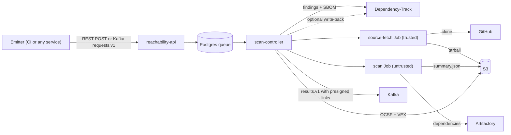

# reachability-pod

reachability-pod tells you which of your open-source vulnerabilities actually matter. Software composition analysis (SCA) flags every vulnerable dependency, whether or not your code ever calls the vulnerable function. That is why Dependency-Track (DT) projects fill up with findings that nobody can triage. reachability-pod takes one GitHub repo at one commit, builds it, and checks each DT finding against a call graph of your code. Each finding gets a verdict: REACHABLE, POTENTIALLY_REACHABLE, NOT_REACHABLE or UNKNOWN. A reachable verdict comes with the call path that proves it. Results are written to S3 as OCSF 2002 Vulnerability Findings and as CycloneDX and OpenVEX documents, so SIEM tools, dashboards and DT itself can use them.

> **Status: implementation started (phase 1).**
> Implemented so far: the `contracts` module (request schema validation) and the `reachability-api` intake: `POST /api/v1/scans`, `GET /api/v1/scans/{scanId}`, `GET /api/v1/scans`, and the Kafka consumer with its DLQ, writing to the Postgres queue. Scans stay QUEUED until the scan-controller lands. Everything else below is the **planned interface** from [docs/architecture.md](docs/architecture.md); see [Build and run](#build-and-run) and the [Roadmap](#roadmap). Names may still change before the phase 0 schema freeze (risk R15). Proposed design choices are marked "Proposed" in [docs/decisions.md](docs/decisions.md) until the owner reviews them.

Owner: AppSec, Arik.

## Contents

- [Features](#features)
- [Supported languages](#supported-languages)
- [How it works](#how-it-works)
- [Quick start for integrators](#quick-start-for-integrators)
- [Verdicts explained](#verdicts-explained)
- [Outputs](#outputs)
- [Dependency-Track integration](#dependency-track-integration)
- [Deployment overview](#deployment-overview)
- [Configuration highlights](#configuration-highlights)
- [Security model](#security-model)
- [Documentation map](#documentation-map)
- [Build and run](#build-and-run)
- [Roadmap](#roadmap)
- [Open questions](#open-questions)
- [License](#license)
- [Ownership and contact](#ownership-and-contact)

## Features

All features are planned. None is implemented yet.

- **Function-level reachability** for Java (Maven, Gradle), Python, Go and JS/TS on day 1 (D-012, D-013).
- **Dependency-Track as the source of truth.** Findings come from DT 5.x `/api/v1`. Finding identity is (componentUuid, vulnerabilityUuid) (D-003).
- **One contract, two channels.** Submit an OCSF 1.9.0 Scan Activity (class_uid 6007) by REST or on Kafka (D-002, D-005).
- **Evidence, not just labels.** Each verdict carries a reason code, an analysis level (SYMBOL, CLASS_OR_PACKAGE or IMPORT) and call paths (D-014, D-015).
- **Standard outputs on S3:** OCSF 2002, CycloneDX 1.6 VEX, OpenVEX and a `summary.json` (D-016).
- **Completion event on Kafka** with presigned download links. Links can be re-signed at any time (D-017).
- **Bulk results API** for dashboards, with sync paging and async export (D-018).
- **Optional DT write-back** in COMMENT, VEX or ANALYSIS mode. Default is OFF (D-004).
- **Configurable scheduling:** priority classes, aging, and global, org and repo concurrency caps, editable at runtime (D-007).
- **Hardened builds:** untrusted code runs in a separate namespace with no GitHub access and no credentials beyond a short-lived Artifactory read token (D-008, D-009, D-011).
- **Dedupe:** a repeat scan of the same repo, commit and finding set reuses the earlier result (D-020).
- **Sized for 10,000 scans per day** (D-020; the figures are estimates to be measured).
- **Sys-admin console** for queue, policies, caps, write-back and knowledge-base overrides (D-026).

## Supported languages

| Language | Build tools | Day 1 | Engine (planned) | Notes |
|---|---|---|---|---|
| Java | Maven, Gradle | Function level | SootUp 3.0.1; fallback OPAL | Java 25 classfile support is UNVERIFIED (R1). DI and reflection need phase 2 entry-point models. |
| Python | pip, uv, Poetry | Function level | Pinned in-house PyCG fork; fallback Joern pysrc2cpg; last resort import scan | Dynamic features (getattr, importlib, decorators, C extensions) can cause false negatives. |
| Go | Go modules | Function level | govulncheck v1.9.0 | Uses the Go vulndb. A DT finding absent from the vulndb is UNKNOWN / NO_SYMBOL_DATA. |
| JavaScript / TypeScript | npm, pnpm, Yarn | Function level | Jelly 0.13.0; fallback import-level | Dynamic `require` and `eval` limit accuracy. Timeouts give POTENTIALLY_REACHABLE / ENGINE_TIMEOUT. |
| C#, Rust | | Expansion (phase 3) | TBD | Accepted today; import-level or UNKNOWN until the expansion lands. |
| Other languages | | Expansion | none | Accepted; import-level or UNKNOWN. |
| C / C++ | | Not analysed | none | Always UNKNOWN / UNSUPPORTED_LANGUAGE. |

Snyk (`snyk test --reachability`, Preview) is a later engine behind the same SPI, in phase 3 (D-022).

## How it works



1. An emitter sends an OCSF Scan Activity with a repo URL, a full commit SHA and a DT project name and version. It uses `POST /api/v1/scans` or the `appsec.reachability.requests.v1` topic.
2. reachability-api validates the request against the JSON Schema, checks the caller's role and stores it in the Postgres queue as QUEUED. REST returns 202 with a `scanId`. Kafka intake commits the offset only after the insert commits (D-006).
3. scan-controller claims the next request by priority, aging and caps (D-007). It reads the project's findings and CycloneDX SBOM from DT. If the same repo, commit and finding set was scanned within the dedupe window, it reuses that result.
4. A source-fetch Job in the trusted namespace clones the commit with submodules, using a GitHub App token. It uploads a tarball to S3 through a presigned URL (D-008).
5. A scan Job in the untrusted namespace downloads the tarball, detects modules, and builds them against Artifactory only (D-011).
6. The engines build call graphs and search for paths from entry points to the vulnerable symbols in the knowledge base (D-013, D-014). The Job writes only `summary.json`.
7. The controller validates `summary.json`, indexes verdicts and call paths, and renders `ocsf.json`, `cyclonedx-vex.json` and `openvex.json` to S3. If write-back is enabled, it updates DT (D-004).
8. The controller publishes a Completed event with presigned links on `appsec.reachability.results.v1`. Every state change also goes to `appsec.reachability.status.v1` (D-017).

The full lifecycle, state machine and retry rules are in [docs/architecture.md](docs/architecture.md), section 4.

## Quick start for integrators

These examples show the **planned interface**. Nothing is deployed yet. Hostnames such as `reach.example.internal` are placeholders.

### 1. Get access

You need:

- An OIDC client in your organization's identity provider, with the `scan-submitter` role to submit and the `results-reader` role to read (D-024).
- For Kafka: write access to `appsec.reachability.requests.v1` and read access to `appsec.reachability.results.v1`.
- A DT project named and versioned for your repo. One GitHub repo maps to one DT project (D-019).
- The organization's GitHub App installed on your repo, so the service can clone it.

See [docs/integration-guide.md](docs/integration-guide.md) for details.

### 2. Submit a scan by REST

```bash
TOKEN="<OIDC access token with the scan-submitter role>"

curl -sS -X POST "https://reach.example.internal/api/v1/scans" \
  -H "Authorization: Bearer ${TOKEN}" \
  -H "Content-Type: application/json" \
  -d '{
    "class_uid": 6007, "category_uid": 6, "activity_id": 1, "type_uid": 600701,
    "time": 1792886400000,
    "metadata": {"version": "1.9.0", "uid": "ci-7f3a2c", "product": {"name": "ci-pipeline"}},
    "scan": {"type": "reachability", "uid": "ci-7f3a2c"},
    "unmapped": {"reachability": {
      "schema_version": "1",
      "repo": {"url": "https://github.com/acme/payments", "commit": "4f1c9e2b7d3a8e6f0b5c1d2e3f4a5b6c7d8e9f0a"},
      "dt_project": {"name": "acme/payments", "version": "main", "uuid": null},
      "priority": "pr",
      "formats": ["ocsf", "cyclonedx-vex", "openvex"],
      "dt_write_back": "OFF",
      "link_ttl": "PT24H"
    }}
  }'
```

The service returns `202 Accepted` with a `Location` header and a body holding `scanId`, `status`, the effective `priority_class` and `dt_write_back`, and any `warnings[]` ([docs/architecture.md, section 5.4a](docs/architecture.md#54a-contract-details-v1)). The request schema is [docs/contracts/scan-request.v1.schema.json](docs/contracts/scan-request.v1.schema.json). `metadata.uid` is the idempotency key. If you send the same `metadata.uid` again, you get the existing `scanId` back.

### 3. Or submit a scan on Kafka

```text
Topic:   appsec.reachability.requests.v1
Key:     any value (the service ignores it)
Value:   the same JSON body as the REST example, UTF-8
```

```bash
# Example with the stock Kafka console producer. The request must be on one line.
kafka-console-producer.sh \
  --bootstrap-server kafka.example.internal:9093 \
  --producer.config client.properties \
  --topic appsec.reachability.requests.v1 \
  --property parse.key=true --property key.separator='|' < request.txt
```

```text
acme/payments|{"class_uid":6007,"category_uid":6,"activity_id":1,"type_uid":600701,"time":1792886400000,"metadata":{"version":"1.9.0","uid":"ci-7f3a2c","product":{"name":"ci-pipeline"}},"scan":{"type":"reachability","uid":"ci-7f3a2c"},"unmapped":{"reachability":{"schema_version":"1","repo":{"url":"https://github.com/acme/payments","commit":"4f1c9e2b7d3a8e6f0b5c1d2e3f4a5b6c7d8e9f0a"},"dt_project":{"name":"acme/payments","version":"main","uuid":null},"priority":"pr","formats":["ocsf","cyclonedx-vex","openvex"],"dt_write_back":"OFF","link_ttl":"PT24H"}}}
```

A record that fails schema validation goes to `appsec.reachability.requests.dlq.v1` with the original bytes and the headers `reach-error-code`, `reach-error-detail`, `reach-schema-version` and `reach-received-at`.

### 4. Poll the status

```bash
curl -sS "https://reach.example.internal/api/v1/scans/${SCAN_ID}" \
  -H "Authorization: Bearer ${READER_TOKEN}"
```

The response holds the status, timestamps, verdict counts and reason. The status is one of QUEUED, FETCHING, SCANNING, PUBLISHING, SUCCEEDED, PARTIAL, FAILED or CANCELLED. The response fields are defined in [docs/architecture.md, section 5.4a](docs/architecture.md#54a-contract-details-v1); a failed scan carries a reason code such as `DT_PROJECT_NOT_FOUND`. Errors use RFC 9457 problem+json.

You can also list scans for a repo and commit:

```bash
curl -sS "https://reach.example.internal/api/v1/scans?repo=acme/payments&commit=4f1c9e2b7d3a8e6f0b5c1d2e3f4a5b6c7d8e9f0a" \
  -H "Authorization: Bearer ${READER_TOKEN}"
```

Cancel a scan in QUEUED, FETCHING or SCANNING. A scan in PUBLISHING returns 409.

```bash
curl -sS -X POST "https://reach.example.internal/api/v1/scans/${SCAN_ID}/cancel" \
  -H "Authorization: Bearer ${TOKEN}"
```

### 5. Consume the completion event

Subscribe to `appsec.reachability.results.v1`. The key is `<dt_project_name>@<dt_project_version>`, for example `acme/payments@main`. Each record is an OCSF Scan Activity with `activity_id` 2:

```json
{
  "class_uid": 6007, "activity_id": 2, "type_uid": 600702, "time": 1792886880000,
  "metadata": {"version": "1.9.0", "uid": "b1e0d6c4-5f7a-4c1e-9a7b-2d3e4f5a6b7c",
               "correlation_uid": "ci-7f3a2c", "product": {"name": "reachability-pod"}},
  "scan": {"type": "reachability", "uid": "b1e0d6c4-5f7a-4c1e-9a7b-2d3e4f5a6b7c"},
  "status_id": 1, "status": "Success",
  "unmapped": {"reachability": {
    "schema_version": "1",
    "scan_status": "PARTIAL",
    "dt_project": {"name": "acme/payments", "version": "main", "uuid": "0b6f..."},
    "counts": {"REACHABLE": 3, "POTENTIALLY_REACHABLE": 5, "NOT_REACHABLE": 41, "UNKNOWN": 2},
    "links": {"ocsf": "https://...", "cyclonedx_vex": "https://...", "openvex": "https://...",
              "summary": "https://..."},
    "links_expire_at": "2026-10-26T00:08:00Z",
    "reused_from": null, "image_digest": "sha256:..."
  }}
}
```

- `metadata.correlation_uid` is your request's `metadata.uid`. Use it to match the event to your request.
- `scan.uid` is the `scanId`. Delivery is at-least-once, so dedupe on it.
- Failed and cancelled scans do not appear here. They appear on `appsec.reachability.status.v1`.

### 6. Download the results

The links are presigned S3 GET URLs. You need no AWS credentials.

```bash
OCSF_URL=$(jq -r '.unmapped.reachability.links.ocsf' completed-event.json)
curl -sS -o ocsf.json "${OCSF_URL}"
```

### 7. Re-sign expired links

Links expire after `link_ttl` (default 24 hours). Re-signing is always available while the S3 objects exist (D-017, D-025). `ttl` is an ISO 8601 duration, capped at `reach.s3.link-ttl-max` (proposed P7D). The response holds the same `links` object as the completion event; formats you did not request are omitted.

```bash
curl -sS -X POST "https://reach.example.internal/api/v1/scans/${SCAN_ID}/links?ttl=PT12H" \
  -H "Authorization: Bearer ${READER_TOKEN}"
```

### 8. Query results in bulk by DT project

```bash
curl -sS -X POST "https://reach.example.internal/api/v1/results/query" \
  -H "Authorization: Bearer ${READER_TOKEN}" \
  -H "Content-Type: application/json" \
  -d '{
    "dt_projects": [{"name": "acme/payments", "version": "main"}],
    "verdicts": ["REACHABLE", "POTENTIALLY_REACHABLE"],
    "latest_only": true
  }'
```

The query is cursor-paged: pass `page_size` (max `reach.results.page-size`) and the opaque `next_cursor` from the previous response as `cursor`. `from` and `to` are ISO 8601 timestamps. Results above `reach.results.sync-max-rows` (default 10,000) return 422 `EXPORT_REQUIRED`. Use `POST /api/v1/results/exports` for those.

## Verdicts explained

Every DT finding in the project gets exactly one verdict. The table says what a developer should do.

| Verdict | Meaning | What to do |
|---|---|---|
| REACHABLE | The engine found a call path from your code to a known vulnerable function. | Fix first. Upgrade the component or remove the call. The call path in `ocsf.json` shows where your code enters. |
| POTENTIALLY_REACHABLE | Your code uses the vulnerable package or class, but the service cannot prove the vulnerable function is called. Common causes: only class or package data, a fallback engine, or an engine timeout. | Treat as real until reviewed. Check the reason and level, read the advisory, and decide. Upgrade if it is cheap. |
| NOT_REACHABLE | Symbol data was available, the analysis completed, and no path reaches the vulnerable code. | Lower priority. Do not ignore it forever: still upgrade in normal maintenance. Re-scan after code changes, because a new call can make it reachable. |
| UNKNOWN | The service could not decide. The reason code says why, for example BUILD_FAILED, UNSUPPORTED_LANGUAGE, NO_SYMBOL_DATA or COMPONENT_NOT_RESOLVED (proposed). | Triage as you would without this service. If the reason is BUILD_FAILED, fix the build issue and re-scan. |

When one component resolves in several modules, the finding takes the strongest verdict: REACHABLE > POTENTIALLY_REACHABLE > UNKNOWN > NOT_REACHABLE.

### Reading the level

`level` tells you how precise the verdict is (D-014):

| Level | Meaning |
|---|---|
| SYMBOL | The knowledge base had function or method symbols, and the primary engine completed. Highest precision. |
| CLASS_OR_PACKAGE | Only class or package data, or a fallback engine. REACHABLE is downgraded to POTENTIALLY_REACHABLE. |
| IMPORT | Last resort: an import scan. Only POTENTIALLY_REACHABLE (imported) or NOT_REACHABLE (not imported). |

### Accuracy caveats

- **Static analysis has blind spots.** Reflection, dependency injection, dynamic imports, `eval` and plugin loading can hide real calls. This produces false NOT_REACHABLE verdicts. Python NOT_REACHABLE has lower confidence.
- **Day-1 entry points are conservative.** Java treats `main` methods and all public methods of application classes as entry points. Python treats all module-level code and functions as entry points. Framework models arrive in phase 2 (R13).
- **Symbol data is sparse.** Public advisories often lack vulnerable function names. Many verdicts start at CLASS_OR_PACKAGE level, or UNKNOWN / NO_SYMBOL_DATA (R14).
- **Results depend on the DT SBOM.** Mapping findings to modules uses the SBOM dependency graph. An incomplete SBOM leads to COMPONENT_NOT_RESOLVED.
- **The image changes weekly.** The scanner image digest is recorded per scan (`image_digest`), so you can explain a changed verdict.
- **Precision and recall targets** are set in phase 0 against a labelled benchmark. They are not published yet.
- **Failures are never silent.** A failed build gives UNKNOWN with a reason, not NOT_REACHABLE (D-015).

## Outputs

Each scan writes to one S3 prefix (D-016):

```text
s3://<bucket>/<org>/<repo>/<commit>/<scanId>/
  ocsf.json
  cyclonedx-vex.json
  openvex.json
  summary.json
```

| File | Content | Typical consumer |
|---|---|---|
| `ocsf.json` | Array of OCSF 2002 Vulnerability Findings, one per DT finding. The trait is in `finding_info.traits[]`. Verdict, reason, level, engine and call paths are in `unmapped.reachability`. | SIEM, data lake, dashboards |
| `cyclonedx-vex.json` | CycloneDX 1.6 VEX. `affects[].ref` is the component purl. | Dependency-Track, supply-chain tools |
| `openvex.json` | OpenVEX. Product is the component purl, with a subcomponent per module. | Sigstore and OpenVEX tools |
| `summary.json` | Raw engine output: modules, toolchains, per-finding verdict, reason, level, call paths, image digest. Always written. | Debugging, audits |

A request can narrow `formats` to a subset of `ocsf`, `cyclonedx-vex` and `openvex`. The default is all three. Objects are kept for 1 year by default and Postgres state for 90 days (D-025).

## Dependency-Track integration

The service reads from DT on every scan and writes to DT only if you enable it (D-003, D-004, D-019).

**Read path** (needs VIEW_PORTFOLIO and VIEW_VULNERABILITY):

1. Look up the project by name and version.
2. Read all active findings for the project.
3. Read the CycloneDX SBOM with its dependency graph to map findings to modules.

**Write-back modes** (default OFF):

| Mode | What DT sees | DT permission |
|---|---|---|
| OFF | Nothing. DT is untouched. | read only |
| COMMENT | A comment and analysis details on each finding. The analysis state is not changed. | VULNERABILITY_ANALYSIS_UPDATE |
| VEX | `cyclonedx-vex.json` uploaded to the project, filtered to the configured verdicts. | VULNERABILITY_ANALYSIS(_UPDATE) |
| ANALYSIS | NOT_REACHABLE findings set to `NOT_AFFECTED` with justification `CODE_NOT_REACHABLE`. | VULNERABILITY_ANALYSIS_UPDATE |

- Precedence: request override, then REPO policy, then ORG policy, then GLOBAL policy. Modes rank OFF < COMMENT < VEX < ANALYSIS; a request may pick an equal or lower mode than the policy, and a higher one is lowered with a warning.
- VEX and ANALYSIS apply only to the verdicts in `reach.dt.writeback.verdicts` (default NOT_REACHABLE).
- Proposed guard: the service does not overwrite an analysis that someone else set, unless its state is NOT_SET or IN_TRIAGE.
- Risk: DT vuln policies may overwrite write-back (R7, UNVERIFIED). A divergence metric tracks this.
- A write-back failure never changes the scan status.

You can always import `cyclonedx-vex.json` into DT by hand. See [docs/integration-guide.md](docs/integration-guide.md).

## Deployment overview

The service runs on OpenShift in three namespaces. Install and run steps are in [docs/operations-guide.md](docs/operations-guide.md).

| Dependency | Use | Notes |
|---|---|---|
| OpenShift | Runs services and Jobs | Namespaces `reach`, `reach-fetch`, `reach-scan`. A dedicated tainted scanner MachineSet for `reach-scan`. No Kata (D-009). |
| PostgreSQL 18 | Queue, scan state, results index, knowledge base | Schemas `scan` and `kb`. Monthly partitions (D-001, D-025). |
| Apache Kafka | Intake, status, results and export events | Plain Apache Kafka. Schema registry optional (D-023). |
| AWS S3 | Source tarballs, input bundles and results | VPC endpoint policy pinned to the bucket. IAM user keys needed for link TTL over 12 hours (D-017). |
| JFrog Artifactory | The only dependency source for builds | Per-job read-only token (D-011). |
| Dependency-Track 5.x | Findings and SBOM; optional write-back | `/api/v1`. Separate read and write API keys (proposed) (D-003). |
| GitHub App | Clones repos in the trusted fetch Job | Installation tokens go only to the fetch Job (D-021). |
| OIDC provider | REST authentication and roles | Any provider (D-024). |

| Component | Kind | Namespace |
|---|---|---|
| reachability-api | Deployment, 2+ replicas | `reach` |
| scan-controller | Deployment, 2 replicas, one leader | `reach` |
| symbol-kb-builder | CronJob | `reach` |
| source-fetch Job | Job per scan | `reach-fetch` (trusted) |
| scan Job | Job per scan, polyglot image | `reach-scan` (untrusted) |

## Configuration highlights

All values are proposed defaults unless a decision sets them. The full list is in [docs/architecture.md, section 12 (Configuration reference)](docs/architecture.md#12-configuration-reference).

| Key | Default | What it controls |
|---|---|---|
| `reach.queue.classes.<name>.weight` | critical 1000, pr 500, default 100, bulk 10 | Priority class weights |
| `reach.queue.global-max-running` | 170 | Global concurrency cap |
| `reach.queue.org-max-running` / `repo-max-running` | unset / 2 | Per-org and per-repo caps |
| `reach.dedupe.window` | P1D | How long a result can be reused |
| `reach.job.scan.active-deadline` | PT45M | Hard limit per scan Job |
| `reach.dt.writeback.mode` | OFF | Global write-back mode (D-004) |
| `reach.dt.writeback.verdicts` | NOT_REACHABLE | Verdicts written in VEX and ANALYSIS modes |
| `reach.s3.link-ttl` | PT24H | Presigned link lifetime (D-017) |
| `reach.retention.s3` / `reach.retention.postgres` | P365D / P90D | Retention (D-025) |
| `reach.results.sync-max-rows` / `page-size` | 10000 / 500 | Bulk query limits |
| `quarkus.oidc.roles.role-claim-path` | `groups` | OIDC claim that holds the roles |
| `reach.github.allowed-hosts` | `github.com` | Hosts a request's `repo.url` may name |

Priority classes, caps, write-back policies and KB overrides seed from config and can then be changed at runtime through the admin API, with hot reload (D-007).

## Security model

- **Two-stage isolation (D-008).** A trusted Job clones the source. Untrusted repo code is built only in `reach-scan`, which can reach Artifactory and the service's S3 bucket and nothing else.
- **No credentials in untrusted pods.** The scan Job holds no GitHub, DT, Kubernetes or AWS credentials. It gets only presigned S3 URLs and a short-lived Artifactory read token (D-009, D-011, D-021).
- **Pod hardening without Kata (D-009).** restricted-v2 SCC (restricted-v3 with user namespaces on OCP 4.20+), read-only root FS, no service-account token, storage limits, `backoffLimit: 0`, one Job per scan and no reused workers.
- **Egress control.** Default-deny NetworkPolicy plus EgressFirewall. S3 is pinned to the bucket by the VPC endpoint policy.
- **Untrusted output is checked.** The scan Job writes only `summary.json`. The controller validates it against a schema, caps its size, and restricts it to the input finding set. The controller renders all published files.
- **Authentication.** Any OIDC provider. Roles: `scan-submitter`, `results-reader`, `sys-admin` (D-024). Kafka security (SASL or mTLS) is configurable; the config default is PLAINTEXT, so set it explicitly.
- **Secrets.** HashiCorp Vault; the DT API key is a static Vault secret (D-032). Job pods get only short-lived per-job credentials.
- **Known trade-off.** Link TTL over 12 hours needs long-lived IAM user keys for signing (D-017, R9).

## Documentation map

| Document | Audience | Content |
|---|---|---|
| [docs/architecture.md](docs/architecture.md) | Everyone | The design: components, lifecycle, contracts, data model, engines, security, configuration. Source of truth for names. |
| [docs/decisions.md](docs/decisions.md) | Reviewers | Decision log D-001 to D-034, with status and rationale. |
| [docs/open-questions.md](docs/open-questions.md) | Owner, reviewers | Everything still undecided, in one list. |
| [docs/CHANGELOG.md](docs/CHANGELOG.md) | Integrators | Contract and docs changes. |
| [docs/integration-guide.md](docs/integration-guide.md) | Teams that send requests or read results | Request and result contracts, examples, bulk API, errors. |
| [docs/contracts/](docs/contracts/) | Integrators | Request JSON Schema v1 (`scan-request.v1.schema.json`) and example request and completion events. Draft until the phase 0 freeze. |
| [docs/operations-guide.md](docs/operations-guide.md) | Platform and sys-admins | Deployment, configuration, monitoring, runbooks. |
| [docs/faq.md](docs/faq.md) | Everyone | Common questions. |
| [CONTRIBUTING.md](CONTRIBUTING.md) | Contributors | Build, test, conventions, and how to propose changes and decisions. |
| [deploy/local/README.md](deploy/local/README.md) | Contributors | Local stack (Postgres, Kafka, mock identity provider) for manual runs. |

## Build and run

You need Java 25, Maven 3.9+ and Docker. The tests start their own Postgres through Quarkus Dev Services, and Kafka runs in memory, so nothing else needs to be installed.

```bash
mvn verify                      # build and run all tests
```

To try the service by hand, start the local stack and run the API against it. The [deploy/local](deploy/local/README.md) README has the details.

```bash
docker compose -f deploy/local/docker-compose.yml up -d --wait
export REACH_LOCAL_PUBLIC_KEY=$(deploy/local/token.sh --public-key)
mvn -pl reachability-api -am package -DskipTests
java -Dquarkus.profile=local -jar reachability-api/target/quarkus-app/quarkus-run.jar

TOKEN=$(deploy/local/token.sh scan-submitter results-reader)
curl -i -X POST localhost:8080/api/v1/scans -H "Authorization: Bearer $TOKEN" \
  -H 'Content-Type: application/json' --data @docs/contracts/scan-request.v1.example.json
```

| Module | State |
|---|---|
| `contracts` | Done for the request: JSON Schema from `docs/contracts`, parser, repo URL rules |
| `reachability-api` | Intake (REST and Kafka with DLQ), status and list endpoints, Liquibase schema. Re-sign, bulk query, exports and admin API come later |
| `scan-controller`, `scanner`, `engines/*`, `symbol-kb-builder` | Not started |

OpenAPI is served at `/q/openapi`, health at `/q/health`, and Prometheus metrics at `/q/metrics` (`reach_intake_requests_total{source,outcome,code}`).

## Roadmap

| Phase | Scope | Exit gate |
|---|---|---|
| 0 Decide and spike | SootUp, PyCG fork and Jelly on sample repos; labelled benchmark; OCSF JSON Schema; OCP version check | Risks R1, R2, R3, R5 resolved; precision and recall baselines agreed with Arik; schema v1 frozen |
| 1 Platform and day 1 | API, controller, Jobs, queue, outputs, Kafka, bulk API; Java, Python, Go, JS/TS | End to end in staging for 4 languages; egress denial and no-SA-token verified by test |
| 2 Depth | Framework entry-point models, library summaries, DT write-back modes, KB growth | Write-back tested against staging DT, including R7; benchmark meets targets |
| 3 Scale and expansions | 10k/day load test, C#, Rust, Snyk engine | Sustained 10k/day within alert thresholds; capacity figures measured |

Phase 1 implementation has started with the intake (see [Build and run](#build-and-run)). The phase 0 spikes (engines, benchmark, schema freeze) still run in parallel. Still to come in phase 1 besides the engines and outputs: the retention job (partition drops, `request_key` pruning, D-025).

## Open questions

The contract details are defined in [docs/architecture.md, section 5.4a](docs/architecture.md#54a-contract-details-v1) and [docs/contracts/scan-request.v1.schema.json](docs/contracts/scan-request.v1.schema.json) (D-028, Proposed). Still open:

- The request schema is a draft until the phase 0 freeze (R15).
- Proposed values in D-028 await the owner's review, including the 6-month v1/v2 overlap and the P7D link TTL cap.
- Priority classes above `default` on Kafka: records carry no verifiable producer identity, so an operator allow-list (`reach.auth.kafka-priority-classes`) is used for now.

## License

MIT. See [LICENSE](LICENSE).

## Ownership and contact

Owner: AppSec, Arik.
