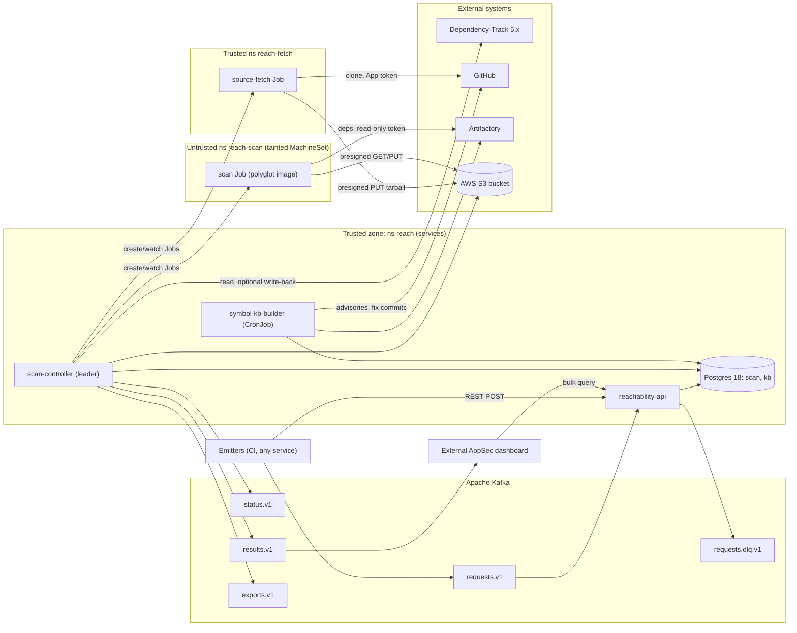
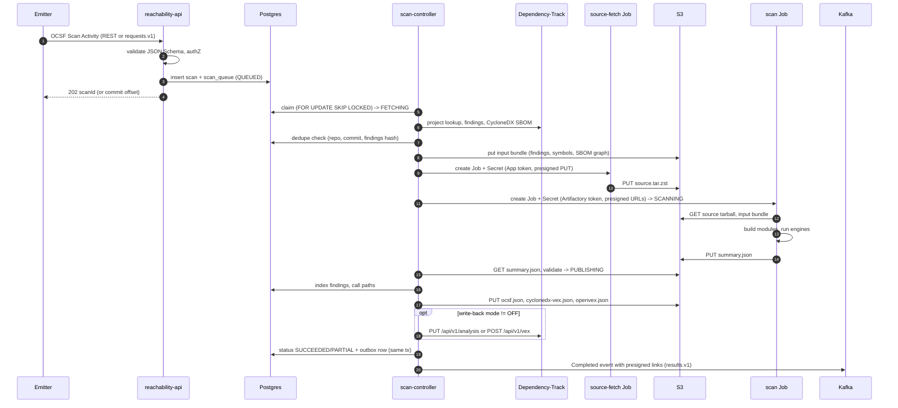
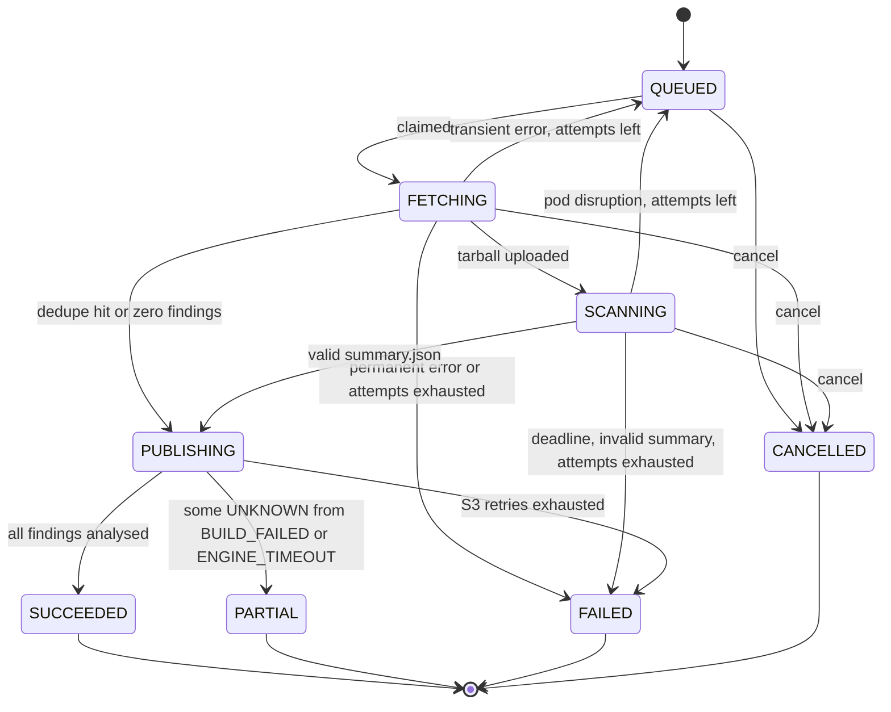

# reachability-pod architecture

Status: Draft, 2026-10-25. Owner: Arik.
Decisions: [decisions.md](decisions.md)

"Proposed default" marks a value chosen here, not by a decision. UNVERIFIED marks a researched claim not yet tested.

## 1. Context and scope

reachability-pod receives a scan request, fetches a GitHub repo at one commit, builds it, and decides for each Dependency-Track (DT) finding whether the vulnerable code is reachable. Results go to S3 as OCSF and VEX; completion is announced on Kafka with presigned links.

In scope:
- Intake of OCSF Scan Activity via REST or Kafka only (D-002, D-005).
- Postgres queue with configurable priority, aging and caps (D-006, D-007).
- Two-stage Job isolation on OpenShift without Kata (D-008, D-009).
- Function-level reachability for Java (Maven, Gradle), Python, Go, JS/TS (D-012, D-013).
- Vulnerable-symbol knowledge base (D-014).
- Outputs: OCSF 2002, CycloneDX 1.6 VEX, OpenVEX, summary (D-016); bulk results API (D-018).
- Optional DT write-back, default OFF (D-004).
- Sys-admin console inside reachability-api (D-026).

Out of scope:
- AppSec dashboards and any per-team division of results; they consume the bulk API (D-018, D-026).
- Consuming DT notifications. A DT-to-OCSF adapter, if ever built, lives outside this service (D-005).
- Snyk: a later engine behind the same SPI (D-022).
- C/C++: accepted, always UNKNOWN / UNSUPPORTED_LANGUAGE. Other languages: accepted, import-level or UNKNOWN until expansion (D-012).
- Multi-tenancy (D-026).

## 2. System context



Trust rules: untrusted code runs only in `reach-scan`, which reaches only Artifactory and our S3 bucket and holds no GitHub, DT, Kubernetes or AWS credentials (D-008, D-009). The OSV and SAP Project KB feeds used by symbol-kb-builder are fetched from trusted namespace `reach`.

## 3. Components

### 3.1 reachability-api
- Responsibility: REST intake, Kafka intake consumer, status, cancel, re-sign, bulk query and exports, admin API, sys-admin UI (Qute + htmx) (D-026).
- Runs as: Deployment in `reach`, 2+ replicas, stateless.
- Tech: Quarkus 3.40 LTS on Java 25 (D-001), quarkus-oidc (D-024), Kafka client, JSON Schema validation (D-023).
- Scaling: horizontal; Kafka consumer group partitions bound intake parallelism.
- Failure: intake commits the Kafka offset only after the Postgres insert commits (D-006); duplicates are absorbed by the request-uid unique key; schema-invalid records go to the DLQ; DB down stops consumption (no offset commit).

### 3.2 scan-controller
- Responsibility: claim queue, DT fetch, dedupe, KB lookup, input bundle to S3, launch fetch Job then scan Job, watch via SharedInformer, validate `summary.json`, index results, render outputs, DT write-back, outbox relay to Kafka.
- Runs as: Deployment in `reach`, 2 replicas; the active leader holds a Postgres advisory lock; the standby takes over on lock loss.
- Tech: Quarkus, quarkus-kubernetes-client (Fabric8) SharedInformer by label; Role in `reach-fetch` and `reach-scan` with create/get/list/watch/delete on jobs, pods, pods/log, plus create/delete secrets for per-job Secrets.
- Scaling: one leader; the work is I/O-bound (DT, S3, Kubernetes API). Jobs carry the CPU load.
- Failure: all state lives in Postgres; a new leader resyncs the informer and reconciles every non-terminal scan against live Jobs. Kafka publishing uses the transactional outbox, so publishing is at-least-once and consumers dedupe on scan uid.

### 3.3 source-fetch Job
- Responsibility: clone the commit with recursive submodules, tar, upload via presigned PUT (D-008).
- Runs as: Job in `reach-fetch` (trusted), one per scan, restricted-v2 SCC.
- Credentials: GitHub App installation token from a per-job Secret (D-021). No AWS credentials; only a presigned PUT URL.
- Egress: GitHub and S3 only.
- Failure: non-zero exit maps to a FETCHING failure (retry rules in 4.2). Single PUT is limited to 5 GB; a larger tarball fails with SOURCE_TOO_LARGE.

### 3.4 scan Job
- Responsibility: download tarball and input bundle, detect modules, build with the image's toolchains against Artifactory, run engines, upload `summary.json` via presigned PUT.
- Runs as: Job in `reach-scan` (untrusted), polyglot image (D-010), arbitrary UID, one Job per scan, no reuse (D-009).
- Internal budget: the runner stops engines before `activeDeadlineSeconds` and writes a partial summary.
- Failure: per-module build or engine failures produce UNKNOWN verdicts with reason codes, never a failed Job. Only infrastructure failures fail the Job.

### 3.5 symbol-kb-builder
- Responsibility: populate `kb` from Go OSV symbols, GHSA vulnerable_functions, fix-commit method diffs (OSV FIX refs, SAP Project KB), and refresh the offline Go vulndb zip (D-014).
- Runs as: CronJob in `reach`.
- Scaling: incremental by advisory modified time.
- Failure: stale KB lowers verdict level but never blocks scans; staleness is alerted (section 10).

## 4. Scan lifecycle

### 4.1 End to end



The controller renders the OCSF and VEX files from the indexed results. The untrusted Job writes only `summary.json`, which is validated against its schema, size-capped, and restricted to the input finding set (assumption; see the report list).

### 4.2 Status state machine



Retry rules (limits configurable, section 12):

| Situation | Class | Behaviour |
|---|---|---|
| GitHub 5xx/timeout, S3 5xx, DT 5xx/timeout | transient | back to QUEUED with `not_before = now + backoff`, `attempt++`, keep priority and original `enqueued_at` |
| Pod evicted or node lost (podFailurePolicy `DisruptionTarget`) | transient | same as above; the Job is not counted against the build |
| DT project not found, commit not found, schema-invalid request | permanent | FAILED, no retry |
| `activeDeadlineSeconds` exceeded, `summary.json` missing or invalid | permanent | FAILED; the Job has `backoffLimit: 0` (D-009) |
| Module build fails, engine timeout | not a failure | finding verdict UNKNOWN or POTENTIALLY_REACHABLE with reason; scan ends PARTIAL |
| S3/DT write-back/outbox error in PUBLISHING | transient | retried in place; write-back failure never changes scan status (logged per finding) |
| Cancel in FETCHING/SCANNING | user | delete Job (foreground), emit Cancelled on status.v1 |
| Cancel in PUBLISHING | user | rejected with 409; publishing is short and idempotent |

## 5. Contracts

### 5.1 Input: OCSF Scan Activity (class_uid 6007, OCSF 1.9.0)

Any `activity_id` is accepted (D-002). `unmapped.reachability` is validated against a versioned JSON Schema (D-023).

```json
{
  "class_uid": 6007, "category_uid": 6, "activity_id": 1, "type_uid": 600701,
  "time": 1792886400000,
  "metadata": {"version": "1.9.0", "uid": "ci-7f3a2c", "product": {"name": "ci-pipeline"}},
  "scan": {"type": "reachability", "uid": "ci-7f3a2c"},
  "unmapped": {"reachability": {
    "schema_version": "1",
    "repo": {"url": "https://github.com/acme/payments", "commit": "4f1c9e2b7d3a8e6f0b5c1d2e3f4a5b6c7d8e9f0a"},
    "dt_project": {"name": "acme/payments", "version": "main", "uuid": null},
    "priority": "pr",
    "formats": ["ocsf", "cyclonedx-vex", "openvex"],
    "dt_write_back": "OFF",
    "link_ttl": "PT24H"
  }}
}
```

| Field | Rule |
|---|---|
| `repo.url` | `https://<host>/<org>/<repo>` with an optional `.git`; the host must be in `reach.github.allowed-hosts`; credentials, port, query and fragment are rejected (D-033) |
| `repo.commit` | full 40-hex SHA; branch names rejected |
| `dt_project` | name + version required; uuid optional, and if given it must match the name/version lookup (D-002, D-019) |
| `priority` | priority class name; unknown, disabled or not permitted names fall back to `default` with warning `PRIORITY_DOWNGRADED` (D-007); permission rule in 5.4a j |
| `formats` | subset of ocsf, cyclonedx-vex, openvex; default all (D-016); `summary.json` is always written |
| `dt_write_back` | per-request override of mode; it may only narrow the org/repo policy, ranking in 5.4a i (D-004, D-028) |
| `metadata.uid` | idempotency key; resubmission returns the existing scanId |
| `link_ttl` | positive ISO 8601 duration; default `reach.s3.link-ttl`, capped at `reach.s3.link-ttl-max` (5.4a c) |

Required fields and types: [contracts/scan-request.v1.schema.json](contracts/scan-request.v1.schema.json) (D-028).

### 5.2 Completion event (results.v1)

```json
{
  "class_uid": 6007, "activity_id": 2, "type_uid": 600702, "time": 1792886880000,
  "metadata": {"version": "1.9.0", "uid": "b1e0d6c4-5f7a-4c1e-9a7b-2d3e4f5a6b7c",
               "correlation_uid": "ci-7f3a2c", "product": {"name": "reachability-pod"}},
  "scan": {"type": "reachability", "uid": "b1e0d6c4-5f7a-4c1e-9a7b-2d3e4f5a6b7c"},
  "status_id": 1, "status": "Success",
  "unmapped": {"reachability": {
    "schema_version": "1",
    "scan_status": "PARTIAL",
    "dt_project": {"name": "acme/payments", "version": "main", "uuid": "0b6f..."},
    "counts": {"REACHABLE": 3, "POTENTIALLY_REACHABLE": 5, "NOT_REACHABLE": 41, "UNKNOWN": 2},
    "links": {"ocsf": "https://...", "cyclonedx_vex": "https://...", "openvex": "https://...",
              "summary": "https://..."},
    "links_expire_at": "2026-10-26T00:08:00Z",
    "reused_from": null, "image_digest": "sha256:..."
  }}
}
```

The status.v1 topic carries one Scan Activity per state transition. Terminal Error and Cancelled events go there (D-017). OCSF 1.9.0 Scan Activity `activity_id` values used: 1 Started, 2 Completed, 3 Cancelled, 6 Error (`type_uid` = 600700 + activity_id). Intermediate states (FETCHING, SCANNING, PUBLISHING) are sent as activity_id 99 Other with the state in `status`.

### 5.3 REST endpoints

Roles are scan-submitter, results-reader and sys-admin (D-024).

| Method, path | Role | Purpose |
|---|---|---|
| `POST /api/v1/scans` | scan-submitter | intake; returns 202 with `scanId` and `Location` |
| `GET /api/v1/scans/{scanId}` | results-reader | status, timestamps, counts, reason |
| `GET /api/v1/scans?repo=&commit=&status=&cursor=` | results-reader | list scans |
| `POST /api/v1/scans/{scanId}/cancel` | scan-submitter | cancel (rules in 4.2) |
| `POST /api/v1/scans/{scanId}/links?ttl=` | results-reader | re-sign presigned links; always available (D-017) |
| `POST /api/v1/results/query` | results-reader | sync paged query with cursor, up to `reach.results.sync-max-rows`; beyond that returns 422 `EXPORT_REQUIRED` (D-018) |
| `POST /api/v1/results/exports` | results-reader | async export to S3 (NDJSON or OCSF), returns 202 and exportId; done event on exports.v1 |
| `GET /api/v1/results/exports/{exportId}` | results-reader | export status and presigned link |
| `GET/PUT /api/v1/admin/priority-classes` | sys-admin | weights, aging, class caps (hot reload) |
| `GET/PUT /api/v1/admin/concurrency-limits` | sys-admin | global, org and repo caps |
| `GET/PUT /api/v1/admin/writeback-policies` | sys-admin | write-back mode per org/repo |
| `GET/POST/DELETE /api/v1/admin/kb/overrides` | sys-admin | KB symbol curation |
| `GET /api/v1/admin/queue`, `POST /api/v1/admin/scans/{id}/requeue` | sys-admin | queue view, manual requeue |

The query body takes `dt_projects: [{name, version}]` (primary), `repos[]`, `vuln_ids[]` (CVE/GHSA/OSV, alias-matched), `purls[]`, `verdicts[]`, `from`/`to`, and `latest_only` (default true: only the newest terminal scan per DT project+version).

### 5.4 Kafka topics

Payloads are JSON validated in-service; a schema registry is optional (D-023). Keys, retention and partition counts are proposed defaults and all configurable.

| Topic | Key | Payload | Retention (proposed default) |
|---|---|---|---|
| `appsec.reachability.requests.v1` | emitter's choice (ignored) | OCSF Scan Activity request | 7 d |
| `appsec.reachability.requests.dlq.v1` | original key | original bytes + error headers (5.4a g) | 14 d |
| `appsec.reachability.status.v1` | scanId | Scan Activity per transition, incl. Error/Cancelled | 7 d |
| `appsec.reachability.results.v1` | `<dt_project_name>@<dt_project_version>` (5.4a h) | Scan Activity Completed (activity_id 2) | 7 d |
| `appsec.reachability.exports.v1` | exportId | export done/failed + presigned link | 7 d |

### 5.4a Contract details (v1)

This subsection fixes the v1 wire details that 5.1 to 5.4 leave open. Values marked "proposed" are proposed defaults (D-028). The request schema is [contracts/scan-request.v1.schema.json](contracts/scan-request.v1.schema.json); examples are [contracts/scan-request.v1.example.json](contracts/scan-request.v1.example.json) and [contracts/scan-completed.v1.example.json](contracts/scan-completed.v1.example.json).

Conventions: REST timestamps are ISO 8601 UTC strings; OCSF `time` stays epoch milliseconds. `scanId` and `exportId` keep the names used in 5.3; every other REST field is snake_case. Clients ignore unknown fields.

**a. Error body.** Every 4xx/5xx REST response is `application/problem+json` (RFC 9457):

```json
{"type": "https://reach.example.internal/problems/schema-invalid", "title": "Request does not match the schema",
 "status": 400, "detail": "2 schema violations", "code": "SCHEMA_INVALID",
 "errors": [{"pointer": "/unmapped/reachability/repo/commit", "message": "must match ^[0-9a-f]{40}$"},
            {"pointer": "/unmapped/reachability/dt_project/version", "message": "required"}]}
```

| Status | `code` | When |
|---|---|---|
| 400 | `SCHEMA_INVALID` | body fails the JSON Schema or a 5.1 rule (`errors[]` lists each violation by JSON Pointer) |
| 400 | `INVALID_PARAMETER` | bad query parameter (`ttl`, `page_size`, `status`) or a cursor from another filter |
| 401 | `UNAUTHENTICATED` | missing, expired or invalid bearer token |
| 403 | `FORBIDDEN` | token lacks the role in 5.3 |
| 404 | `SCAN_NOT_FOUND` / `EXPORT_NOT_FOUND` | unknown `scanId` / `exportId` |
| 409 | `SCAN_NOT_CANCELLABLE` | cancel in PUBLISHING or in a terminal state (4.2) |
| 409 | `RESULTS_NOT_AVAILABLE` | re-sign for a scan that has no published files (not SUCCEEDED or PARTIAL) |
| 410 | `RESULTS_EXPIRED` | re-sign after S3 retention removed the objects (D-025) (proposed) |
| 422 | `EXPORT_REQUIRED` | sync query matches more than `reach.results.sync-max-rows` (D-018) |
| 500 | `INTERNAL_ERROR` | unexpected server error; details are only in the service log |
| 503 | `UNAVAILABLE` | Postgres unavailable (section 11); retry with backoff; carries `Retry-After` |

`errors[]` is present only for 400. `type` URIs are stable identifiers; clients branch on `code`.

**b. Scan resources.** `POST /api/v1/scans` returns 202, header `Location: /api/v1/scans/{scanId}`. An idempotent resubmission (same `metadata.uid`) returns 202 with the existing scan and `"duplicate": true`.

```json
{"scanId": "b1e0d6c4-5f7a-4c1e-9a7b-2d3e4f5a6b7c", "request_uid": "ci-7f3a2c", "status": "QUEUED",
 "duplicate": false, "priority_class": "pr", "dt_write_back": "OFF",
 "created_at": "2026-10-25T23:00:00Z", "warnings": []}
```

`priority_class` and `dt_write_back` are the effective values after rules i and j. `warnings[]` holds `{code, detail}` items (`PRIORITY_DOWNGRADED`, `WRITE_BACK_NARROWED`, `LINK_TTL_CAPPED`).

`GET /api/v1/scans/{scanId}`:

```json
{"scanId": "b1e0d6c4-5f7a-4c1e-9a7b-2d3e4f5a6b7c", "request_uid": "ci-7f3a2c",
 "status": "PARTIAL", "reason": null, "reason_detail": null, "attempt": 1,
 "repo": {"url": "https://github.com/acme/payments", "commit": "4f1c9e2b7d3a8e6f0b5c1d2e3f4a5b6c7d8e9f0a"},
 "dt_project": {"name": "acme/payments", "version": "main", "uuid": "0b6f..."},
 "priority_class": "pr", "dt_write_back": "OFF", "formats": ["ocsf", "cyclonedx-vex", "openvex"],
 "created_at": "2026-10-25T23:00:00Z", "enqueued_at": "2026-10-25T23:00:00Z",
 "claimed_at": "2026-10-25T23:00:04Z", "finished_at": "2026-10-25T23:08:00Z",
 "counts": {"REACHABLE": 3, "POTENTIALLY_REACHABLE": 5, "NOT_REACHABLE": 41, "UNKNOWN": 2},
 "reused_from": null, "image_digest": "sha256:...", "warnings": []}
```

`reason` is a code from rule f when `status` is FAILED, or the last retryable code while a retried scan is QUEUED; otherwise null. `counts` is null until PUBLISHING ends. The resource carries no links; use re-sign (c).

`GET /api/v1/scans?repo=&commit=&status=&page_size=&cursor=`: `repo` is `<org>/<repo>`, `commit` a full SHA, `status` a comma-separated list of 4.2 states, `page_size` up to `reach.results.page-size`. All filters are optional and ANDed. Order is `created_at` descending.

```json
{"items": [{"scanId": "b1e0d6c4-...", "request_uid": "ci-7f3a2c", "status": "PARTIAL", "reason": null,
            "repo": {"url": "https://github.com/acme/payments", "commit": "4f1c9e2b..."},
            "dt_project": {"name": "acme/payments", "version": "main"},
            "created_at": "2026-10-25T23:00:00Z", "finished_at": "2026-10-25T23:08:00Z"}],
 "next_cursor": "eyJjIjoiMjAyNi0xMC0yNVQyMzowMDowMFoiLCJpZCI6ImIxZTAifQ"}
```

`next_cursor` is opaque and absent on the last page. Pass it back as `cursor` with the same filters.

**c. Re-sign.** `POST /api/v1/scans/{scanId}/links?ttl=PT12H`. `ttl` is an ISO 8601 duration (days, hours, minutes, seconds; no years, months or weeks). It defaults to `reach.s3.link-ttl` and is capped at `reach.s3.link-ttl-max` (proposed P7D, the IAM-user presign maximum, D-017): a larger value is cut to the cap with warning `LINK_TTL_CAPPED`. The same cap applies to the request's `link_ttl`. Response 200, the links object of rule d:

```json
{"links": {"ocsf": "https://...", "summary": "https://..."}, "links_expire_at": "2026-10-26T11:00:00Z", "warnings": []}
```

For a deduped scan the links point at the `reused_from` scan's objects.

**d. `links` object.** Keys: `ocsf`, `cyclonedx_vex`, `openvex`, `summary`. A format the request did not ask for is omitted, never null. `summary` is always present. The same object appears in results.v1, in status.v1 Completed events and in the re-sign response.

**e. status.v1 layout.** One Scan Activity per transition, key `scanId`. Common fields as in 5.2: `class_uid` 6007, `type_uid` = 600700 + `activity_id`, `metadata.uid` = `scan.uid` = scanId, `metadata.correlation_uid` = request `metadata.uid`, and `unmapped.reachability.{schema_version, scan_status, dt_project}`, plus `attempt` on every event except Completed.

| State | `activity_id` | `status_id`, `status` | Extra fields |
|---|---|---|---|
| QUEUED (first) | 1 Started | 99, `"QUEUED"` | `warnings[]` (e.g. `PRIORITY_DOWNGRADED`) |
| QUEUED (retry), FETCHING, SCANNING, PUBLISHING | 99 Other | 99, the state name | retry: `status_detail`, `unmapped.reachability.reason` (retryable code), `retryable: true`, `not_before` |
| SUCCEEDED, PARTIAL | 2 Completed | 1, `"Success"` | identical to the results.v1 event (5.2) |
| CANCELLED | 3 Cancelled | 99, `"CANCELLED"` | none |
| FAILED | 6 Error | 2, `"Failure"` | `status_detail`, `unmapped.reachability.reason`, `retryable: false` |

`status_detail` is a human-readable sentence; `unmapped.reachability.reason` is the code from rule f. Consumers dedupe on (`scan.uid`, `scan_status`, `attempt`).

```json
{"class_uid": 6007, "activity_id": 6, "type_uid": 600706, "time": 1792886410000,
 "metadata": {"version": "1.9.0", "uid": "b1e0d6c4-...", "correlation_uid": "ci-7f3a2c", "product": {"name": "reachability-pod"}},
 "scan": {"type": "reachability", "uid": "b1e0d6c4-..."},
 "status_id": 2, "status": "Failure",
 "status_detail": "DT project acme/payments@main not found",
 "unmapped": {"reachability": {"schema_version": "1", "scan_status": "FAILED", "attempt": 1,
   "reason": "DT_PROJECT_NOT_FOUND", "retryable": false,
   "dt_project": {"name": "acme/payments", "version": "main", "uuid": null}}}}
```

**f. Scan-level reason codes.** These are scan failure codes, separate from the finding reason codes in 5.6.

| Code | Stage | Class | Meaning |
|---|---|---|---|
| `DT_PROJECT_NOT_FOUND` | FETCHING | permanent | name/version lookup returned nothing |
| `DT_UUID_MISMATCH` | FETCHING (at claim) | permanent | request `dt_project.uuid` differs from the lookup result; the scan fails with no retry |
| `COMMIT_NOT_FOUND` | FETCHING | permanent | repo or commit not found or not visible to the GitHub App |
| `SOURCE_TOO_LARGE` | FETCHING | permanent | tarball over the 5 GB single-PUT limit (3.3) |
| `DEADLINE_EXCEEDED` | SCANNING | permanent | `activeDeadlineSeconds` exceeded |
| `INVALID_SUMMARY` | SCANNING | permanent | `summary.json` missing, invalid or oversized |
| `DT_UNAVAILABLE` | FETCHING | retryable | DT 5xx or timeout |
| `GITHUB_UNAVAILABLE` | FETCHING | retryable | GitHub 5xx or timeout (proposed) |
| `S3_UNAVAILABLE` | any | retryable | S3 5xx; in PUBLISHING retried in place (proposed) |
| `POD_DISRUPTED` | SCANNING | retryable | pod evicted or node lost, `DisruptionTarget` (proposed) |

A retryable code fails the scan (FAILED, same code) once `reach.retry.max-attempts` is used up. A schema-invalid request never becomes a scan: REST returns 400 `SCHEMA_INVALID`, Kafka sends the record to the DLQ.

**g. DLQ headers.** On `requests.dlq.v1` the value is the original bytes and the original headers (including `traceparent`) are kept. Added UTF-8 string headers:

| Header | Value |
|---|---|
| `reach-error-code` | `INVALID_JSON`, `SCHEMA_INVALID` or `UNSUPPORTED_SCHEMA_VERSION` |
| `reach-error-detail` | first violations as `<JSON Pointer>: <message>`, truncated to 1 KiB (proposed) |
| `reach-schema-version` | the record's `unmapped.reachability.schema_version`, or `unknown` if unreadable |
| `reach-received-at` | ISO 8601 UTC time the service consumed the record |

**h. results.v1 key.** `<dt_project_name>@<dt_project_version>`, e.g. `acme/payments@main`. Names may themselves contain `@`; consumers read the project from the payload, not by parsing the key.

**i. Write-back narrowing.** Modes rank OFF < COMMENT < VEX < ANALYSIS. The effective mode is the lower of the request's `dt_write_back` and the most specific policy (REPO, then ORG, then GLOBAL, 8.4). A request may pick an equal or lower mode; a higher one is lowered to the policy mode with warning `WRITE_BACK_NARROWED`, and the scan is still accepted.

**j. Priority class permission.** A class whose weight is above `default` requires the OIDC role `reach-priority-<class>` (e.g. `reach-priority-pr`), mapped like the other roles (`quarkus.oidc.roles.role-claim-path`, section 12). Without it the request is downgraded to `default`, and a `PRIORITY_DOWNGRADED` warning goes in the 202 body and the first status event. `default` and lower classes need no extra role. Kafka records carry no verifiable producer identity, so Kafka requests may use only the classes listed in `reach.auth.kafka-priority-classes` (proposed default: empty, so above-`default` classes downgrade).

**k. Bulk query and export.** `POST /api/v1/results/query`; `from` (inclusive) and `to` (exclusive) are ISO 8601 UTC timestamps on the scan's `finished_at`; `page_size` defaults to and is capped at `reach.results.page-size`.

```json
{"dt_projects": [{"name": "acme/payments", "version": "main"}], "repos": [], "vuln_ids": ["CVE-2021-44228"],
 "purls": [], "verdicts": ["REACHABLE"], "from": "2026-10-01T00:00:00Z", "to": "2026-11-01T00:00:00Z",
 "latest_only": true, "page_size": 500, "cursor": null}
```

```json
{"items": [{"finding_uid": "b1e0d6c4-...:9c1d...:77ab...", "scanId": "b1e0d6c4-...",
            "finished_at": "2026-10-25T23:08:00Z",
            "dt_project": {"name": "acme/payments", "version": "main"},
            "repo": {"url": "https://github.com/acme/payments", "commit": "4f1c9e2b..."},
            "component_uuid": "9c1d...", "vulnerability_uuid": "77ab...",
            "vuln_id": "CVE-2021-44228", "aliases": ["GHSA-jfh8-c2jp-5v3q"],
            "purl": "pkg:maven/org.apache.logging.log4j/log4j-core@2.14.1", "module": "service",
            "verdict": "REACHABLE", "reason": null, "level": "SYMBOL", "engine": "sootup"}],
 "next_cursor": "eyJvIjo1MDB9"}
```

`next_cursor` is opaque, bound to the filter, and absent on the last page. 422 `EXPORT_REQUIRED` is returned on the first page when the match count exceeds `reach.results.sync-max-rows`.

Export: `POST /api/v1/results/exports` with `{"filter": {<query body without page_size and cursor>}, "format": "ndjson"}`. `format` is `ndjson` (one query item per line) or `ocsf` (array of OCSF 2002 findings, 5.5). Returns 202 `{"exportId": "...", "status": "QUEUED"}` and `Location`. `GET /api/v1/results/exports/{exportId}` and the exports.v1 value (key `exportId`) share these fields:

```json
{"schema_version": "1", "exportId": "5e2a...", "status": "SUCCEEDED", "format": "ndjson",
 "row_count": 182344, "created_at": "2026-10-25T23:00:00Z", "finished_at": "2026-10-25T23:03:10Z",
 "link": "https://...", "link_expires_at": "2026-10-26T23:03:10Z", "error": null}
```

`status` is QUEUED, RUNNING, SUCCEEDED or FAILED; exports.v1 carries only SUCCEEDED and FAILED. On FAILED, `link` is null and `error` is `{code, detail}`. The link is re-signed on each GET.

**l. Versioning policy (proposed).** Within v1 only additive changes are allowed: new optional request fields, new response or event fields, new warning, error and reason codes. Removing or renaming a field, changing a type or meaning, making a field required, adding a verdict, or changing a key format is breaking. A breaking change ships as `.v2` topics and `/api/v2`, run alongside v1 for at least 6 months (proposed). `schema_version` sits in `unmapped.reachability` (top level for exports.v1) and stays `"1"` for all of v1. Each change is announced in the docs changelog and recorded in decisions.md. Until the phase 0 freeze (R15) v1 may still change.

**m. Emitter auth.** Machine clients use the OIDC client-credentials grant; the token carries the 5.3 roles and any `reach-priority-<class>` role. Kafka principals are named `reach-emitter-<team>` (WRITE, DESCRIBE on `requests.v1`). Consumer groups are prefixed `reach-consumer-<team>` (prefixed READ ACL on the group, READ on the topics the team uses). Kafka security mode is set by `reach.kafka.security` (D-024).

### 5.5 Output files and OCSF 2002 mapping

Prefix: `s3://<bucket>/<org>/<repo>/<commit>/<scanId>/` (D-016).

| File | Content |
|---|---|
| `ocsf.json` | array of OCSF 2002 Vulnerability Finding, one per DT finding |
| `cyclonedx-vex.json` | CycloneDX 1.6 VEX; `affects[].ref` = component purl |
| `openvex.json` | OpenVEX; product = component purl, subcomponent per module |
| `summary.json` | engine output: modules, toolchains, per-finding verdict, reason, level, call paths, image digest |

| OCSF 2002 field | Source |
|---|---|
| `finding_info.uid` | `<scanId>:<componentUuid>:<vulnerabilityUuid>` (D-003) |
| `finding_info.traits[]` | reachability trait (mapping in 5.6) |
| `vulnerabilities[].cve.uid` / `advisory.uid` | DT `vulnId`, `aliases[]` |
| `vulnerabilities[].affected_packages[].purl` | DT `component.purl` |
| `vulnerabilities[].severity`, `is_exploit_available` | DT severity; DT `isKev` |
| `resources[]` | repo URL, commit, module path |
| `unmapped.reachability` | `verdict`, `reason`, `level`, `engine`, `engine_version`, `call_paths[]` (frames: symbol, file, line) |

### 5.6 Verdict mapping (D-015, D-004)

| Verdict | OCSF trait | CycloneDX analysis | OpenVEX | DT write-back |
|---|---|---|---|---|
| REACHABLE | Contributing | `exploitable` | `affected` | COMMENT: details + comment. VEX/ANALYSIS: no state change by default |
| POTENTIALLY_REACHABLE | Contributing | `in_triage` | `under_investigation` | COMMENT only |
| NOT_REACHABLE | Mitigating | `not_affected` + `code_not_reachable` | `not_affected` + `vulnerable_code_not_in_execute_path` | ANALYSIS: `NOT_AFFECTED` + `CODE_NOT_REACHABLE`; VEX: DT maps to `CODE_NOT_REACHABLE` |
| UNKNOWN (+reason) | none | `in_triage` | `under_investigation` | COMMENT only |

Reason codes include NO_SYMBOL_DATA, BUILD_FAILED, ENGINE_TIMEOUT, UNSUPPORTED_LANGUAGE (D-015), plus COMPONENT_NOT_RESOLVED (proposed, see 8.3). `level` is SYMBOL, CLASS_OR_PACKAGE or IMPORT, so a coarse verdict is always labelled (D-014).

## 6. Data model (Postgres 18)

Scan tables are partitioned monthly by `created_at`, and retention drops whole partitions (D-025). Queue and policy tables are small and unpartitioned.

### 6.1 Schema `scan`

| Table | Columns (key ones) | Keys / indexes | Partitioning |
|---|---|---|---|
| `scan` | id uuid, created_at, request_uid, source (REST, KAFKA), submitted_by, org, repo, repo_url, commit_sha, dt_project_name, dt_project_version, dt_project_uuid, priority_class, dt_write_back (effective), status, reason, reason_detail, attempt (starts at 1), enqueued_at, claimed_at, finished_at, findings_hash, image_digest, s3_prefix, reused_from, options jsonb (formats, effective link_ttl, requested priority and write-back, warnings), request jsonb | PK (id, created_at); idx (status) WHERE status not terminal; idx (org, repo, commit_sha, findings_hash); idx (dt_project_name, dt_project_version, finished_at) | monthly |
| `request_key` | request_uid PK, scan_id, scan_created_at, created_at | idempotency for 5.1 | none (pruned with partitions) |
| `scan_queue` | scan_id PK, scan_created_at, priority_class, org, repo, enqueued_at, not_before, attempt | idx (not_before); row exists only while QUEUED | none |
| `finding` | scan_id, created_at, component_uuid, vulnerability_uuid, vuln_id, aliases text[], purl, module, verdict, reason, level, engine, dt_project_name, dt_project_version, repo, writeback_status | PK (scan_id, component_uuid, vulnerability_uuid, created_at); idx (dt_project_name, dt_project_version, created_at); idx (vuln_id); GIN (aliases); idx (purl); idx (verdict, created_at) | monthly |
| `call_path` | scan_id, created_at, component_uuid, vulnerability_uuid, seq, frames jsonb | PK (scan_id, component_uuid, vulnerability_uuid, seq, created_at) | monthly |
| `outbox` | id bigserial, topic, key, payload jsonb, headers jsonb, created_at, published_at | PK id; idx (id) WHERE published_at IS NULL | none; published rows purged |
| `priority_class` | name PK, weight int, aging_per_min numeric, max_running int null, enabled | seeded from config, edited via admin API | none |
| `concurrency_limit` | scope (GLOBAL, ORG, REPO), key, max_running | PK (scope, key) | none |
| `writeback_policy` | scope (GLOBAL, ORG, REPO), key, mode, verdicts text[], updated_by, updated_at | PK (scope, key); most specific wins | none |
| `export` | id uuid PK, requester, query jsonb, format, status, s3_key, row_count, created_at, finished_at | idx (status) | none |

Hot reload: admin writes trigger `NOTIFY reach_policy`, and the controller reloads on that and on a periodic refresh (D-007).

The schema is managed by Liquibase (D-031). The changelog is in `reachability-api/src/main/resources/db/changelog/`. Monthly partitions of `scan.scan` are created ahead of time by the SQL function `scan.ensure_monthly_partitions(parent, months_ahead)`. Liquibase calls it once, and reachability-api calls it at start-up and daily (`reach.partitions.*`, D-033). Intake writes the `scan`, `request_key` and `scan_queue` rows and the first status event in the `outbox` in one transaction.

### 6.2 Claim query

The leader runs this in a loop while free capacity is above zero. SKIP LOCKED keeps a claim safe during leader handover overlap (D-006).

```sql
WITH running AS (
  SELECT org, repo, priority_class, count(*) AS n
  FROM scan.scan WHERE status IN ('FETCHING','SCANNING','PUBLISHING')
  GROUP BY org, repo, priority_class
), cand AS (
  SELECT q.scan_id
  FROM scan.scan_queue q
  JOIN scan.priority_class pc ON pc.name = q.priority_class AND pc.enabled
  LEFT JOIN scan.concurrency_limit lo ON lo.scope = 'ORG'  AND lo.key = q.org
  LEFT JOIN scan.concurrency_limit lr ON lr.scope = 'REPO' AND lr.key = q.org || '/' || q.repo
  WHERE q.not_before <= now()
    AND (lo.max_running IS NULL OR lo.max_running >
         (SELECT coalesce(sum(n),0) FROM running r WHERE r.org = q.org))
    AND (lr.max_running IS NULL OR lr.max_running >
         (SELECT coalesce(sum(n),0) FROM running r WHERE r.org = q.org AND r.repo = q.repo))
    AND (pc.max_running IS NULL OR pc.max_running >
         (SELECT coalesce(sum(n),0) FROM running r WHERE r.priority_class = q.priority_class))
  ORDER BY pc.weight + pc.aging_per_min * extract(epoch FROM now() - q.enqueued_at) / 60 DESC,
           q.enqueued_at
  LIMIT :batch
  FOR UPDATE OF q SKIP LOCKED
)
DELETE FROM scan.scan_queue q USING cand
WHERE q.scan_id = cand.scan_id
RETURNING q.scan_id;
```

- `:batch = min(reach.queue.claim-batch, global cap - running total)`.
- Caps are checked against the state before the batch, so a batch can overshoot a per-org cap by at most `batch - 1`. The proposed default batch of 1 removes the overshoot. At 10k/day one claim per round trip is enough.
- In the same transaction the controller sets `scan.status = 'FETCHING'`.
- Aging is linear: after `(w_high - w_low) / aging_per_min` minutes a low class outranks a fresh high-class request, so no class starves (D-007).
- The sort expression is not indexable. It runs over `scan_queue`, which holds only QUEUED rows.

### 6.3 Schema `kb` (D-014)

| Table | Columns | Keys / indexes |
|---|---|---|
| `vulnerability` | vuln_id PK, aliases text[], ecosystem, source, modified_at | GIN (aliases) |
| `fix_commit` | vuln_id, repo_url, commit_sha, source (OSV_FIX, SAP_KB) | PK (vuln_id, repo_url, commit_sha) |
| `vulnerable_symbol` | id, vuln_id, package (versionless purl), symbol (FQN), kind (FUNCTION, METHOD, CLASS, PACKAGE), source (OSV_GO, GHSA, FIX_DIFF, MANUAL) | idx (package, vuln_id) |
| `symbol_version` | symbol_id, introduced, fixed, last_affected | idx (symbol_id) |
| `library_summary` | purl (versioned), engine, engine_version, s3_key, created_at | PK (purl, engine, engine_version) |
| `override` | id, vuln_id, package, action (ADD_SYMBOL, REMOVE_SYMBOL, FORCE_VERDICT), symbol, verdict, author, reason, created_at | idx (package, vuln_id) |

Lookup is by (package, vulnId), with DT `aliases[]` tried in order. Overrides apply last.

## 7. Reachability engines

### 7.1 Day-1 engines (D-012, D-013)

| | Java | Python | Go | JS/TS |
|---|---|---|---|---|
| Engine, version | SootUp 3.0.1 (LGPL-2.1); fallback OPAL | in-house pinned PyCG fork (Apache-2.0); fallback Joern pysrc2cpg | govulncheck v1.9.0 | Jelly 0.13.0 (BSD-3); fallback import-level |
| Inputs | app bytecode + runtime classpath per module | app source + deps installed from lockfile | module source, offline vulndb zip | package source + `node_modules`, generated vulns file |
| Build/install | Maven: `mvn -B package -DskipTests` + `dependency:build-classpath -DincludeScope=runtime` per module; Gradle: init script prints `sourceSets.main.runtimeClasspath` + `output.classesDirs` (Gradle 9.x) | `pip install --target` or venv from lockfile (pip, uv, Poetry) | none beyond module download via GOPROXY | `npm ci` / `pnpm i` / Yarn via Artifactory, per workspace package |
| Command / API | SootUp Java API in-process, CHA default, RTA, Qilin points-to optional | PyCG CLI, JSON call graph | `govulncheck -db file://<vulndb> -format json ./...` (exit 0) | `jelly -v vulns.json --matches-file ... --callstacks-json ... -i <timeout>` |
| Output parsing | call-graph search from entry points to KB methods; shaded classes mapped to purl via `pom.properties` | search graph for vulnerable FQN | `finding` records; `trace[0]` is the vulnerable symbol; joined to DT via OSV aliases | matches + callstacks JSON |
| Verdict rules | KB method reached: REACHABLE. Only class-level data and class reached: POTENTIALLY_REACHABLE. Data present, analysis complete, not reached: NOT_REACHABLE | FQN reached: REACHABLE. Package imported, no symbol data: POTENTIALLY_REACHABLE (NO_SYMBOL_DATA). Not reached or not imported: NOT_REACHABLE (lower confidence) | symbol-level trace: REACHABLE. Package-level (imported, not called) or module-only: NOT_REACHABLE. DT finding absent from Go vulndb: UNKNOWN (NO_SYMBOL_DATA) | function match: REACHABLE. Package-level match only: POTENTIALLY_REACHABLE. No match: NOT_REACHABLE. Timeout: POTENTIALLY_REACHABLE (ENGINE_TIMEOUT) |
| Limitations | DI, reflection, lambdas need entry-point models (phase 2); Java 25 classfiles UNVERIFIED | getattr, importlib, decorators, C extensions cause false negatives; upstream archived 2023 | uses Go vulndb, not DT data | dynamic require/eval; partial results on timeout |

Day-1 entry points before the phase-2 framework models: `main` methods plus all public methods of application classes (Java), and all module-level code and functions of application source (Python). These are conservative proposed defaults. Other languages get import-level verdicts or UNKNOWN; C/C++ gets UNKNOWN / UNSUPPORTED_LANGUAGE.

### 7.2 SPI

```java
public interface ReachabilityEngine {
  String id();                              // "sootup", "opal", "pycg", "joern-py", "govulncheck", "jelly", "import-scan"
  String version();
  Set<Ecosystem> ecosystems();
  int rank();                               // lower runs first; next rank is the fallback
  boolean supports(ModuleDescriptor module);
  PreparedModule prepare(ModuleDescriptor module, BuildEnv env) throws BuildException;
  EngineResult analyse(PreparedModule module, List<TargetFinding> targets, Duration budget);
}
record TargetFinding(UUID componentUuid, UUID vulnerabilityUuid, String purl, String vulnId,
                     List<String> aliases, List<VulnerableSymbol> symbols) {}
record EngineResult(List<FindingVerdict> verdicts, boolean complete, List<String> diagnostics) {}
record FindingVerdict(TargetFinding target, Verdict verdict, ReasonCode reason, Level level,
                      List<CallPath> paths) {}
```

Engines are discovered via CDI in the scan runner. Snyk (`snyk test --reachability`, Preview) plugs in later as another implementation (D-022).

### 7.3 Knowledge base sources and fallback levels

Sources in precedence order: Go OSV `imports.symbols`, then GHSA `vulnerable_functions` (sparse), then fix-commit method diffs (OSV FIX refs, SAP Project KB; Java, Python), then manual curation via overrides. Steady data is stale (2022) and is not used (D-014).

| Level | When | Verdicts possible |
|---|---|---|
| SYMBOL | KB has function/method symbols and the primary engine completed | all four |
| CLASS_OR_PACKAGE | only class or package data, or a fallback engine | REACHABLE is downgraded to POTENTIALLY_REACHABLE; NOT_REACHABLE only if the package is unreferenced |
| IMPORT | last resort, import AST scan | POTENTIALLY_REACHABLE (imported) or NOT_REACHABLE (not imported) |
| none | unsupported language, build failed | UNKNOWN + reason |

## 8. Dependency-Track integration (D-003, D-019)

### 8.1 Read path
Permissions are VIEW_PORTFOLIO and VIEW_VULNERABILITY.

1. `GET /api/v1/project/lookup?name=&version=`. If the request has a uuid, `GET /api/v1/project/{uuid}` and check it matches the name and version.
2. `GET /api/v1/finding/project/{uuid}`, paginated with offset/limit (default 100). Follow `X-Total-Count` until done. Inactive findings are hidden by default (DT ADR-013), which is the intended behaviour.
3. `GET /api/v1/bom/cyclonedx/project/{uuid}?variant=inventory&version=1.6` for components and the `dependencies` graph. Fallback: `/api/v1/dependencyGraph/project/{uuid}/directDependencies`.
4. `findings_hash = sha256(sorted componentUuid:vulnerabilityUuid pairs)` feeds dedupe.

Finding identity is (componentUuid, vulnerabilityUuid). DT has no finding UUID.

All endpoints are v1. v2 lacks findings, BOM, VEX and analysis. v1 is slated for phase-out (DT ADR-007), but none of these endpoints is `@Deprecated`.

### 8.2 Submodules and the merged SBOM
One repo maps to one DT project with one merged SBOM; submodules are cloned recursively (D-019). The scan Job:
1. Detects modules per ecosystem (pom.xml, build.gradle(.kts), pyproject.toml/requirements, go.mod, package.json workspaces), including inside submodules.
2. Maps each finding purl to modules by walking the SBOM dependency graph from the module's root component.
3. Falls back to any module whose own resolved classpath or lockfile contains the purl.

### 8.3 Unresolved components
A finding whose purl resolves in no module gets UNKNOWN / COMPONENT_NOT_RESOLVED (proposed reason code). A finding that resolves in several modules takes the strongest verdict across them (REACHABLE > POTENTIALLY_REACHABLE > UNKNOWN > NOT_REACHABLE).

### 8.4 Write-back (D-004, default OFF)

| Mode | Endpoint | Payload | Permission | Notes |
|---|---|---|---|---|
| OFF | none | none | read only | default |
| COMMENT | `PUT /api/v1/analysis` | `project, component, vulnerability, analysisDetails, comment` only | VULNERABILITY_ANALYSIS_UPDATE | analysis state untouched |
| VEX | `POST /api/v1/vex` multipart (`project`, `vex`) | `cyclonedx-vex.json`, filtered to `writeback_policy.verdicts` | VULNERABILITY_ANALYSIS(_UPDATE) | async: poll `GET /api/v1/event/token/{uuid}`; PUT base64 variant limited to 20M chars, not used |
| ANALYSIS | `PUT /api/v1/analysis` | NOT_REACHABLE: `analysisState=NOT_AFFECTED`, `analysisJustification=CODE_NOT_REACHABLE`, details + comment | VULNERABILITY_ANALYSIS_UPDATE | one call per finding, rate-limited |

- Precedence: request override, then REPO, then ORG, then GLOBAL policy.
- Guard (proposed): the controller does not overwrite an analysis whose state was set by someone else and is neither NOT_SET nor IN_TRIAGE. It checks via `GET /api/v1/analysis?project=&component=&vulnerability=`.
- Separate DT API keys for read and write (proposed), so a read-only key suffices when the mode is OFF.

### 8.5 Credential rotation and vuln-policy risk
The DT API key is a static secret in HashiCorp Vault (KV v2), read by reachability-api and scan-controller through Vault Kubernetes auth and the `quarkus-vault` config source. It is re-read every `reach.dt.api-key-refresh` (proposed PT5M) (D-032). The service does not rotate it. DT 5 service-account keys expire (max 366d), so `reach_dt_apikey_expiry_days` alerts before expiry. A DT team key does not expire.

Workload identity federation (v2 `POST /oauth/token`, RFC 8693, Kubernetes SA token, 1h session) is a later option. It is UNVERIFIED on OpenShift.

Vuln-policy risk: DT v2 vuln policies (CEL, APPLY/LOG) set analyses during DT's vulnerability analysis. They may overwrite our write-back (UNVERIFIED). Mitigations:
- Test in phase 2.
- On each read, record divergence between the DT analysis and our last write-back as a metric.
- Recommend LOG-mode policies, or CEL conditions that exclude our findings.

## 9. Security and isolation on OpenShift (no Kata) (D-008, D-009)

| Control | `reach` (services) | `reach-fetch` (trusted) | `reach-scan` (untrusted) |
|---|---|---|---|
| SCC | restricted-v2 | restricted-v2 | restricted-v2; restricted-v3 + `hostUsers: false` on OCP 4.20+ |
| Nodes | general | general | dedicated tainted scanner MachineSet; toleration + nodeSelector |
| ServiceAccount | RBAC as in 3.2 | dedicated, no RBAC, `automountServiceAccountToken: false` | same |
| Egress | DT, S3, Kafka, Artifactory, GitHub API, OIDC | GitHub + S3 | Artifactory + S3 only |
| Pod settings | standard | read-only root FS, emptyDir with `sizeLimit` | read-only root FS; emptyDir `/work`, `/tmp`, `$HOME` with `sizeLimit`; ephemeral-storage limits |
| Job settings | n/a | `backoffLimit: 0`, `restartPolicy: Never`, `activeDeadlineSeconds`, `ttlSecondsAfterFinished`, podFailurePolicy | same |
| Quota | n/a | LimitRange, ResourceQuota incl. `count/jobs.batch` | same |

Egress layering:
- Default-deny NetworkPolicy for ingress and egress. Egress is allowed only to DNS (openshift-dns) and to `0.0.0.0/0` minus pod, service and machine CIDRs and `169.254.169.254`. NetworkPolicy and ANP have no FQDN peers.
- EgressFirewall (`k8s.ovn.org/v1`, one per namespace, named `default`): allow `cidrSelector` for AWS S3 ranges, because S3 IPs rotate. Use `dnsName` for Artifactory (`reach-scan`) and GitHub (`reach-fetch`); OVN re-resolves names at most every 30 min. End with a deny `0.0.0.0/0` rule.
- The S3 VPC endpoint policy pins traffic to our bucket and account. A presigned URL for another bucket therefore fails even inside the S3 CIDRs.
- GitHub egress from untrusted code would be an exfiltration channel, so source is fetched in a separate trusted step (D-008).

Secrets and lifetimes (D-032, which supersedes D-021):

| Credential | Holder | Lifetime | Delivery |
|---|---|---|---|
| GitHub App private key | scan-controller | long-lived, rotated by GitHub App owner | Vault (proposed, D-032) |
| GitHub App installation token | source-fetch Job only | GitHub-issued short-lived; not persisted | per-job Secret, owner-referenced to the Job |
| Artifactory read-only token | scan Job | `expires_in` = 2x `activeDeadlineSeconds` (D-011) | per-job Secret; minted via `POST /access/api/v1/tokens` |
| Presigned S3 GET/PUT for Jobs | fetch/scan Job | `activeDeadlineSeconds` + margin (proposed) | per-job Secret |
| DT API key(s) | api, controller | static in Vault; expiry alerted (8.5) | Vault KV v2 (D-032) |
| AWS for services | api, controller, kb-builder | IRSA/STS session 1-12h | projected SA token |
| IAM user keys for long links | controller, api (signing only) | long-lived, rotate | Vault (proposed, D-032); required when link TTL is over 12h, which the 24h default is (D-017) |

Artifactory injection without touching the repo (D-011):

| Manager | Mechanism |
|---|---|
| Maven | `MAVEN_ARGS="-gs /cfg/settings.xml -s /cfg/settings.xml"`, `mirrorOf *`; image `mvn`, never `mvnw` |
| Gradle | init.d script replacing `repositories` and `pluginManagement`; image `gradle`, or a wrapper dist via Artifactory generic remote |
| pip | `PIP_INDEX_URL` |
| uv | `UV_DEFAULT_INDEX`, `UV_PYTHON_DOWNLOADS=never` |
| Poetry | poetry-plugin-pypi-mirror, `POETRY_PYPI_MIRROR_URL` |
| Go | `GOPROXY=<art>/api/go/<virtual>`, `GONOPROXY=none`, `GOSUMDB` via Artifactory, `GOFLAGS=-mod=mod`, `GOTOOLCHAIN=local` |
| npm / pnpm | `npm_config_registry`, `NPM_CONFIG_USERCONFIG` (replace-registry-host) |
| Yarn Berry | `YARN_NPM_REGISTRY_SERVER` |

A repo `.npmrc` (or similar) can override this config. The egress block is the backstop.

Polyglot image (D-010):
- Contents: UBI 9, JDK 25 + Maven + Gradle, Python + pip/uv/Poetry (+ mirror plugin), Go, Node 22 + npm/Yarn/pnpm, SDKMAN, fnm, uv-managed Pythons, all engines.
- Built weekly from a pinned manifest, with all inputs pulled through Artifactory.
- Referenced by digest. The digest is recorded per scan (`scan.image_digest`).
- Pre-pulled on scanner nodes by a DaemonSet.
- Runs as an arbitrary UID: writable paths are group-0 writable or emptyDir.
- A toolchain version not installed in the image fails that module with BUILD_FAILED; there are no runtime toolchain downloads.

## 10. Scale and capacity (D-020)

| Quantity | Value | Basis |
|---|---|---|
| Average arrival | ~7 scans/min | 10,000/day / 1,440 |
| Average concurrency | ~56 | 7/min x 8 min median (assumed) |
| Peak concurrency | ~170 | 3x peak factor (assumed) |
| Peak CPU | ~680 vCPU | 4 vCPU/job (assumed) |
| Jobs created | ~20,000/day | fetch + scan per non-deduped scan |

All four inputs (median, peak factor, vCPU/job, memory/job) are estimates and must be measured in phase 0 and phase 3.

- etcd: finished Jobs, Pods and Events are the main load. The controller collects status, `summary.json` and logs, then the Job is deleted by `ttlSecondsAfterFinished` (proposed default 600s, within the researched 300-3600s range). Job, not bare Pod.
- Dedupe (D-020):
  - At intake, on `metadata.uid`.
  - At claim, on (repo, commit, findings_hash) within `reach.dedupe.window`. A hit completes with `reused_from` and references the original objects.
  - An in-flight duplicate waits for the running scan instead of starting a second Job.
- Caches:
  - Artifactory remote repos are the dependency cache.
  - The offline Go vulndb zip is refreshed by symbol-kb-builder.
  - `kb.library_summary` (phase 2) is computed only by trusted symbol-kb-builder from Artifactory artifacts, never accepted from scan Jobs.
  - No build caches are shared across Jobs (D-009).
- Autoscaling: a MachineAutoscaler on the scanner MachineSet (min/max configurable) reacts to pending scan pods. The global concurrency cap is set at or below the MachineSet max capacity, so the queue, not the cluster, absorbs bursts.
- Back-pressure:
  - The queue is unbounded in Postgres. Intake stays fast because it only inserts.
  - The claim loop stops when running reaches the global cap or pending scan pods exceed `reach.k8s.max-pending-pods`.
  - The bulk class has its own cap (D-007).

## 11. Observability and operations

- Metrics (Micrometer, Prometheus):
  - `reach_queue_depth{class}`, `reach_queue_wait_seconds{class}`
  - `reach_scans_total{status,reason}`, `reach_scan_duration_seconds{stage,ecosystem}`
  - `reach_verdicts_total{verdict,level,ecosystem}`, `reach_engine_duration_seconds{engine}`, `reach_build_failures_total{tool}`
  - `reach_jobs{ns,phase}`, `reach_outbox_lag_seconds`
  - `reach_dt_request_seconds{endpoint,code}`, `reach_dt_apikey_expiry_days`, `reach_dt_analysis_divergence_total`
  - `reach_kb_age_seconds{source}`
- Tracing (OpenTelemetry): one trace per scan. `traceparent` propagates through Kafka headers, the outbox, and Job env.
- Logs: JSON. The controller fetches `pods/log` before TTL deletion and ships them to cluster logging, tagged with scanId. Job logs never contain tokens; per-job Secrets are mounted as files.

| Failure | Detection | Behaviour |
|---|---|---|
| Postgres unavailable | readiness, connection errors | intake returns 503; Kafka consumption pauses with no offset commit; claims stop |
| Controller leader lost | advisory lock released | standby takes lock, resyncs informer, reconciles non-terminal scans |
| DT down or slow | `reach_dt_request_seconds`, 5xx | FETCHING retried with backoff; alert after N failures |
| DT key near expiry | `reach_dt_apikey_expiry_days` below threshold | alert; rotation job |
| GitHub fetch fails | fetch Job exit code | transient: requeue; not found: FAILED |
| Scanner capacity exhausted | pending pods, queue wait p95 | claims pause; MachineAutoscaler adds nodes |
| Build fails in a module | runner diagnostics | UNKNOWN / BUILD_FAILED for that module; scan PARTIAL |
| Job deadline exceeded | Job condition `DeadlineExceeded` | FAILED, no retry |
| `summary.json` invalid or oversized | schema validation | FAILED; scan flagged for review |
| Kafka unavailable | outbox lag | rows stay in outbox; published on recovery, at-least-once |
| Egress violation attempt | OVN ACL logging on deny rule | alert; no behaviour change (blocked) |
| KB stale | `reach_kb_age_seconds` | alert; verdict levels degrade, scans continue |
| etcd object growth | `reach_jobs{phase=finished}` | lower TTL; controller deletes collected Jobs directly |

## 12. Configuration reference

All values are proposed defaults unless a decision sets them. Priority classes and caps here seed the DB, and the admin API edits them at runtime (D-007).

| Key | Default | Note |
|---|---|---|
| `reach.queue.classes.<name>.weight` | critical 1000, pr 500, default 100, bulk 10 | proposed |
| `reach.queue.classes.<name>.aging-per-min` | 1 | proposed |
| `reach.queue.classes.bulk.max-running` | 20 | proposed |
| `reach.queue.global-max-running` | 170 | from D-020 peak estimate |
| `reach.queue.org-max-running` / `repo-max-running` | unset / 2 | proposed |
| `reach.queue.claim-batch` | 1 | proposed |
| `reach.retry.max-attempts` / `backoff` | 3 / PT1M exponential | proposed |
| `reach.dedupe.window` | P1D | proposed |
| `reach.job.scan.active-deadline` | PT45M | proposed |
| `reach.job.fetch.active-deadline` | PT10M | proposed |
| `reach.job.ttl-after-finished` | 600s | proposed (range 300-3600s) |
| `reach.job.scan.cpu` / `memory` / `ephemeral-storage` | 4 / 16Gi / 50Gi | 4 vCPU from D-020; others proposed, to measure |
| `reach.k8s.max-pending-pods` | 20 | proposed |
| `reach.engine.<id>.enabled` / `.timeout` | true / 50% of scan deadline per module | proposed |
| `reach.engine.java.call-graph` | CHA | D-013; RTA, QILIN optional |
| `reach.kb.cron` | hourly | proposed |
| `reach.dt.url`, `reach.dt.api-key-read`, `reach.dt.api-key-write` | none | required; write key only if write-back used |
| `reach.dt.page-size` | 100 | DT default |
| `reach.dt.writeback.mode` | OFF | D-004 |
| `reach.dt.writeback.verdicts` | NOT_REACHABLE | proposed; applies to VEX/ANALYSIS |
| `reach.s3.bucket`, `reach.s3.region` | none | required |
| `reach.s3.link-ttl` | PT24H | D-017; over 12h needs `reach.s3.signer=iam-user` |
| `reach.s3.link-ttl-max` | P7D | proposed; cap for `ttl` on re-sign and request `link_ttl` (5.4a c); P7D is the IAM-user presign maximum |
| `reach.s3.signer` | iam-user | follows from 24h default; `sts` caps at session |
| `reach.retention.s3` / `reach.retention.postgres` | P365D / P90D | D-025 |
| `reach.results.sync-max-rows` / `page-size` | 10000 / 500 | proposed |
| `reach.kafka.bootstrap-servers`, `reach.kafka.security` | none / PLAINTEXT | SASL or mTLS configurable (D-024) |
| `reach.kafka.topics.*` | names in 5.4 | D-005, D-017 |
| `reach.kafka.schema-registry.enabled` | false | D-023 |
| `quarkus.oidc.roles.role-claim-path` | `groups` | token claim that holds the roles; map provider group names with `quarkus.http.auth.roles-mapping."<group>"=<role>`; provider via `quarkus.oidc.*` (D-024, D-033). Replaces the planned `reach.auth.roles.*-claim` |
| `reach.github.allowed-hosts` | `github.com` | hosts a request's `repo.url` may name (5.1, D-033) |
| `reach.kafka.topics.status` | `appsec.reachability.status.v1` | topic of the outbox status events written at intake |
| `reach.partitions.months-ahead` / `reach.partitions.cron` | 3 / `0 15 3 * * ?` | monthly partitions of `scan.scan` kept ready ahead, and when the daily check runs (D-033) |
| `reach.auth.kafka-priority-classes` | empty | proposed; classes above `default` that Kafka requests may use (5.4a j) |
| `reach.artifactory.url`, `reach.artifactory.token-ttl-factor` | none / 2.0 | D-011 |
| `reach.github.app-id`, `reach.github.private-key` | none | required |

## 13. Risks and open items

| # | Item | Status | Impact | Mitigation / next step |
|---|---|---|---|---|
| R1 | SootUp 3.0.1 reading Java 25 classfiles (via ASM 9.8) | UNVERIFIED | Java verdicts on Java 25 builds | phase 0 spike; fallback OPAL (claims 1.0-25) |
| R2 | SootUp LGPL-2.1 | legal check pending | engine choice | legal review in phase 0 |
| R3 | Joern pysrc2cpg site-packages resolution | UNVERIFIED | Python fallback quality | phase 0 spike; else drop to import-level |
| R4 | PyCG fork maintenance (upstream archived 2023) | accepted | Python accuracy, CVE fixes | own fork, pinned, benchmark-gated |
| R5 | User namespaces (`hostUsers: false`) on OCP 4.18/4.19 | UNVERIFIED (TP 4.17, GA 4.20) | isolation depth | confirm OCP version in phase 0; restricted-v2 until 4.20 |
| R6 | DT workload identity federation on OpenShift | UNVERIFIED | key rotation burden | API keys + rotation job until verified |
| R7 | DT vuln policies overwrite write-back | UNVERIFIED | write-back silently lost | default OFF; phase 2 test; divergence metric |
| R8 | DT v1 phase-out (ADR-007) | watch | read/write path | track DT releases; adapter layer per endpoint |
| R9 | Link TTL over 12h needs IAM user keys | accepted (D-017) | long-lived secret | rotate keys; re-sign endpoint lets TTL drop to 12h |
| R10 | S3 IP rotation vs EgressFirewall CIDRs | open | spurious S3 denials | update CIDRs from AWS ranges; VPC endpoint policy is the real pin |
| R11 | Repo-level registry overrides (`.npmrc` etc.) | accepted | build fails, no exfil | egress backstop |
| R12 | Capacity inputs (8-min median, 3x peak, 4 vCPU, memory) | estimate | node count, cost | measure in phase 0 and phase 3 load test |
| R13 | Day-1 entry-point model (all public methods) | proposed | fewer NOT_REACHABLE | framework models in phase 2 |
| R14 | Sparse symbol data (GHSA) | accepted | many CLASS_OR_PACKAGE / NO_SYMBOL_DATA verdicts | fix-commit diffs, curation |
| R15 | OCSF `unmapped.reachability` JSON Schema v1 | open (draft published) | contract freeze | draft in [contracts/scan-request.v1.schema.json](contracts/scan-request.v1.schema.json); freeze in phase 0 (D-028) |

## 14. Delivery phases

| Phase | Scope | Exit gate |
|---|---|---|
| 0 Decide/spike | SootUp, PyCG fork, Jelly on sample repos; labelled benchmark; OCSF JSON Schema; OCP version check | R1, R2, R3, R5 resolved; benchmark precision/recall baselines agreed with Arik; schema v1 frozen |
| 1 Platform + day-1 | api, controller, Jobs, queue, outputs, Kafka, bulk API; Java, Python, Go, JS/TS; others accepted as UNKNOWN/import | end-to-end in staging for 4 languages; egress denial and no-SA-token verified by test; retries and cancel covered |
| 2 Depth | framework entry-point models, library summaries, DT write-back modes, KB growth | write-back modes tested against staging DT incl. R7; benchmark meets agreed targets |
| 3 Scale + expansions | 10k/day load test, C#, Rust, Snyk engine | sustained 10k/day with queue wait and etcd within alert thresholds; capacity figures replaced by measurements |
