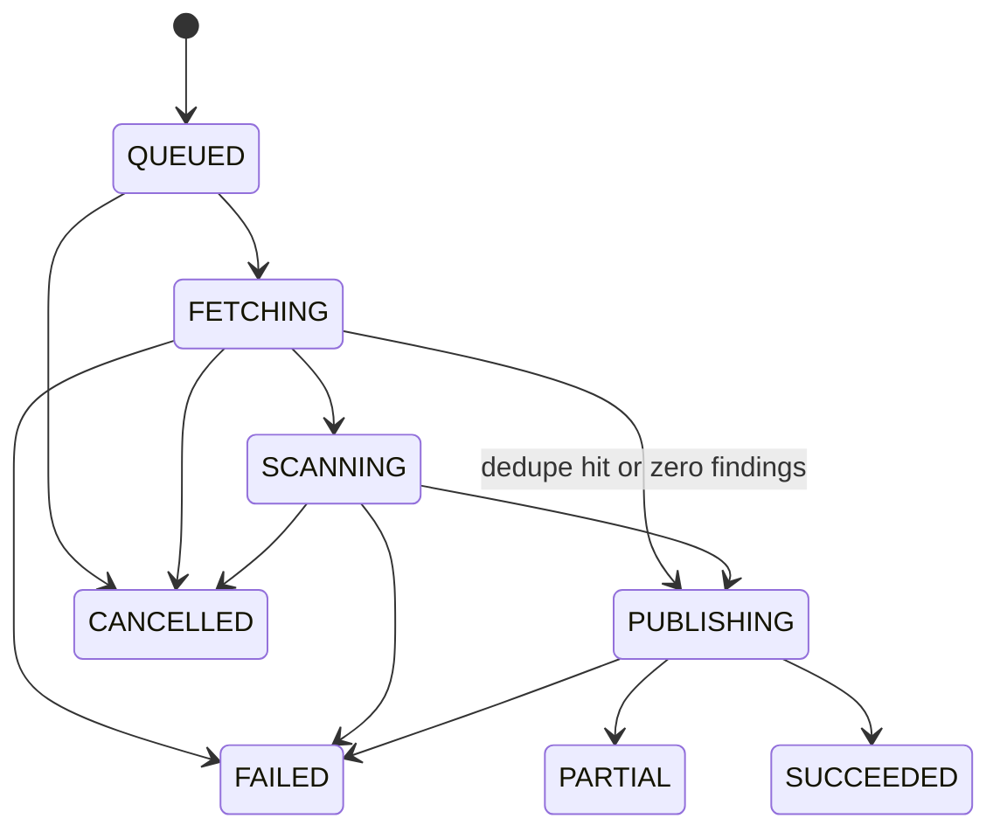

# reachability-pod integration guide

> **Status: design; implementation not started.**
> Everything here is the **planned interface** from [architecture.md](architecture.md). No endpoint or topic exists yet. The v1 contract details are in [architecture.md 5.4a](architecture.md#54a-contract-details-v1) and the request schema is [contracts/scan-request.v1.schema.json](contracts/scan-request.v1.schema.json) (D-028). Names can still change until that schema is frozen at the end of phase 0 (risk R15). Where architecture.md does not define a detail, this guide says so and lists it under [Open questions](#open-questions). Do not build against a guess.

Owner: AppSec, Arik. See also: [README](../README.md), [decisions.md](decisions.md), [operations-guide.md](operations-guide.md), [faq.md](faq.md).

## Contents

1. [Who this is for](#1-who-this-is-for)
2. [Prerequisites](#2-prerequisites)
3. [Request contract](#3-request-contract)
4. [Idempotency, priority and write-back overrides](#4-idempotency-priority-and-write-back-overrides)
5. [Worked examples](#5-worked-examples)
6. [Result contract](#6-result-contract)
7. [Bulk query API](#7-bulk-query-api)
8. [Errors, reason codes and troubleshooting](#8-errors-reason-codes-and-troubleshooting)
9. [Versioning and compatibility](#9-versioning-and-compatibility)
10. [Open questions](#open-questions)

## 1. Who this is for

This guide is for two kinds of teams:

- **Emitters.** CI pipelines and services that ask for a scan. Any service may emit a request (D-005).
- **Consumers.** Services that read results: SIEM pipelines, the external AppSec dashboard, release gates, or teams that import VEX into Dependency-Track (DT).

You do not need to know how the service runs inside. If you operate the service, read [operations-guide.md](operations-guide.md) instead.

What the service will not do for you:

- It does not watch DT. A new vulnerability in DT does not trigger a re-scan. Your emitter must send a request (D-005).
- It does not split results by team. The external dashboard does that through the bulk API (D-018, D-026).
- It is single tenant (D-026).

## 2. Prerequisites

| Need | Who | Details |
|---|---|---|
| OIDC client | Emitters and REST consumers | A client in your organization's identity provider, using the client-credentials grant. The service accepts any OIDC provider (D-024). |
| Role `scan-submitter` | Emitters | Needed for `POST /api/v1/scans` and cancel. |
| Role `results-reader` | Consumers | Needed for status, list, re-sign, bulk query and exports. |
| Kafka ACLs, emitter | Kafka emitters | Principal `reach-emitter-<team>` with WRITE and DESCRIBE on `appsec.reachability.requests.v1`. |
| Kafka ACLs, consumer | Kafka consumers | READ and DESCRIBE on `appsec.reachability.results.v1` (and `status.v1`, `exports.v1` if you use them), plus READ on your own consumer group, which must start with `reach-consumer-<team>`. |
| DT project | Emitters | A DT project that holds your repo's SBOM. You must know its exact **name and version**. The UUID is optional. |
| One repo = one DT project | Emitters | One GitHub repo maps to one DT project with one merged SBOM, including submodules (D-019). Do not split a repo across DT projects. |
| GitHub App on the repo | Repo owners | The organization's reachability GitHub App must be installed on the repo, and on any submodule repos. The trusted fetch Job clones with its installation token (D-008, D-021). |
| Dependencies in Artifactory | Repo owners | Builds pull dependencies only from Artifactory (D-011). Private packages must be resolvable there. |

Roles come from an OIDC claim. The default claim is `groups` (`quarkus.oidc.roles.role-claim-path`); operators can map group names to roles with `quarkus.http.auth.roles-mapping`. Ask the service operators which group grants which role.

Kafka security is configurable (SASL or mTLS) (D-024). Ask the operators for the bootstrap servers and client settings.

## 3. Request contract

The REST body and the Kafka record value are the same document: an OCSF 1.9.0 Scan Activity, `class_uid` 6007 (D-002). Service-specific fields live in `unmapped.reachability`, which is validated against a versioned JSON Schema (D-023): [contracts/scan-request.v1.schema.json](contracts/scan-request.v1.schema.json). A copy of the example below is in [contracts/scan-request.v1.example.json](contracts/scan-request.v1.example.json).

### 3.1 Example

```json
{
  "class_uid": 6007, "category_uid": 6, "activity_id": 1, "type_uid": 600701,
  "time": 1792886400000,
  "metadata": {"version": "1.9.0", "uid": "ci-7f3a2c", "product": {"name": "ci-pipeline"}},
  "scan": {"type": "reachability", "uid": "ci-7f3a2c"},
  "unmapped": {"reachability": {
    "schema_version": "1",
    "repo": {"url": "https://github.com/acme/payments", "commit": "4f1c9e2b7d3a8e6f0b5c1d2e3f4a5b6c7d8e9f0a"},
    "dt_project": {"name": "acme/payments", "version": "main", "uuid": null},
    "priority": "pr",
    "formats": ["ocsf", "cyclonedx-vex", "openvex"],
    "dt_write_back": "OFF",
    "link_ttl": "PT24H"
  }}
}
```

### 3.2 Fields

"Required" matches [contracts/scan-request.v1.schema.json](contracts/scan-request.v1.schema.json). Other OCSF top-level fields are allowed and ignored. Inside `unmapped.reachability` unknown fields are rejected, so a typo fails validation.

| Path | Type | Required | Description | Example |
|---|---|---|---|---|
| `class_uid` | integer | Yes | OCSF Scan Activity class. | `6007` |
| `category_uid` | integer | No | OCSF category (6 = Application Activity). | `6` |
| `activity_id` | integer | Yes | Any value is accepted (D-002). | `1` |
| `type_uid` | integer | No | OCSF type, `class_uid * 100 + activity_id`. | `600701` |
| `time` | integer (ms since epoch) | Yes | When the emitter created the request. | `1792886400000` |
| `metadata.version` | string | Yes | OCSF version (1.x; built against 1.9.0). | `"1.9.0"` |
| `metadata.uid` | string | No; strongly recommended | Idempotency key. A resubmission returns the existing `scanId`. Without it every submission creates a new scan. Echoed back as `correlation_uid`. | `"ci-7f3a2c"` |
| `metadata.product.name` | string | No | Name of the emitter. | `"ci-pipeline"` |
| `scan.type` | string | No | Scan type. | `"reachability"` |
| `scan.uid` | string | Yes | Emitter's scan id. | `"ci-7f3a2c"` |
| `unmapped.reachability.schema_version` | string | Yes | Version of the `unmapped.reachability` schema. Must be `"1"`. | `"1"` |
| `unmapped.reachability.repo.url` | string (URL) | Yes | GitHub repo URL. | `"https://github.com/acme/payments"` |
| `unmapped.reachability.repo.commit` | string | Yes | Full 40-hex commit SHA, lowercase. Branch names are rejected. | `"4f1c9e2b..."` |
| `unmapped.reachability.dt_project.name` | string | Yes | Exact DT project name. | `"acme/payments"` |
| `unmapped.reachability.dt_project.version` | string | Yes | Exact DT project version. | `"main"` |
| `unmapped.reachability.dt_project.uuid` | string or null | No | DT project UUID. If given, it must match the name and version lookup; a mismatch fails the scan with `DT_UUID_MISMATCH`. | `null` |
| `unmapped.reachability.priority` | string | No | Priority class name. Unknown or not permitted names fall back to `default` (section 4.2). | `"pr"` |
| `unmapped.reachability.formats` | array of string | No | Subset of `ocsf`, `cyclonedx-vex`, `openvex`. Default: all three. `summary.json` is always written. | `["ocsf"]` |
| `unmapped.reachability.dt_write_back` | string | No | Per-request write-back mode: `OFF`, `COMMENT`, `VEX` or `ANALYSIS`. Ranked OFF < COMMENT < VEX < ANALYSIS; it may only be equal to or lower than the policy (section 4.3). | `"OFF"` |
| `unmapped.reachability.link_ttl` | string (ISO 8601 duration) | No | Lifetime of presigned links in the completion event. Config default `PT24H`; capped at `reach.s3.link-ttl-max` (proposed P7D). | `"PT24H"` |

### 3.3 Validation rules

Checked at intake, before the request is queued:

- The document must pass the in-service JSON Schema validation (D-023).
- `repo.commit` must be a full 40-hex SHA. A branch or short SHA is rejected.
- `dt_project.name` and `dt_project.version` must be present.
- `formats` may only contain `ocsf`, `cyclonedx-vex` and `openvex`.
- The caller must hold `scan-submitter` (REST).
- A failure returns 400 `SCHEMA_INVALID` with every violation in `errors[]` (section 8.1). On Kafka the record goes to the DLQ.

Soft rules (the request is accepted, the value is adjusted):

- `priority`: an unknown or not permitted class becomes `default`, with warning `PRIORITY_DOWNGRADED` (D-007, section 4.2). If operators disabled `default`, the lowest enabled class is used instead.
- Strings must not contain U+0000 (NUL), and `link_ttl` must fit a Java `Duration`. Both are rejected like schema violations (REST 400 `SCHEMA_INVALID`, Kafka DLQ).
- `repo.url` org and repo are case-insensitive: `https://github.com/ACME/Payments` is the same repository as `acme/payments` for policies, caps, list filters and dedupe.
- `dt_write_back`: a mode above the configured policy is lowered to it, with warning `WRITE_BACK_NARROWED` (D-004, section 4.3).
- `link_ttl`: a value above `reach.s3.link-ttl-max` is cut to it, with warning `LINK_TTL_CAPPED`.

Warnings appear in the 202 body and in the first `status.v1` event.

Checked later, while the scan runs (the scan ends FAILED, no retry; reason codes in section 8.3):

- The DT project name and version must exist in DT (`DT_PROJECT_NOT_FOUND`).
- The commit must exist in the repo (`COMMIT_NOT_FOUND`).
- A given `dt_project.uuid` must match the name and version lookup. This is checked when the scan is claimed; a mismatch fails it with `DT_UUID_MISMATCH`, no retry.

### 3.4 Dead-letter queue (Kafka only)

| Topic | Key | Value | Retention (proposed default) |
|---|---|---|---|
| `appsec.reachability.requests.dlq.v1` | original key | original bytes, plus error headers | 14 days |

- A record that fails schema validation goes to the DLQ. No scan is created, and no status event is emitted for it.
- The service commits the intake offset only after the request is stored in Postgres (D-006). If Postgres is down, consumption pauses. Nothing is lost and nothing goes to the DLQ for that reason.
- The service never retries a DLQ record. Fix the producer and send a new record.
- The original headers are kept. The service adds these headers (UTF-8 strings, architecture.md 5.4a g):

| Header | Value |
|---|---|
| `reach-error-code` | `INVALID_JSON`, `SCHEMA_INVALID`, `UNSUPPORTED_SCHEMA_VERSION`, or `UNPROCESSABLE` (valid, but storing it failed for a reason other than a Postgres outage; D-033) |
| `reach-error-detail` | First violations as `<JSON Pointer>: <message>`, truncated to 1 KiB (proposed) |
| `reach-schema-version` | The record's `unmapped.reachability.schema_version`, or `unknown` |
| `reach-received-at` | ISO 8601 UTC time the service consumed the record |

- Ask the operators for read access to the DLQ if you need to debug your producer.

## 4. Idempotency, priority and write-back overrides

### 4.1 Idempotency and dedupe

There are two layers (D-020):

| Layer | Key | Effect |
|---|---|---|
| Intake idempotency | `metadata.uid` | Same `metadata.uid` again returns the existing `scanId`. No new scan. |
| Result dedupe | (repo, commit, DT findings hash) within `reach.dedupe.window` (default P1D) | A new scan completes without running a Job. The completion event sets `reused_from` to the original scan and points at its objects. |
| In-flight dedupe | same as above | A duplicate waits for the running scan instead of starting a second Job. |

Guidance:

- Derive `metadata.uid` from something stable in your system, such as the CI run id. A CI retry of the same run then does not create a second scan.
- Use a new `metadata.uid` when you really want a new scan, for example after DT gained new findings.
- The findings hash comes from DT. If DT's findings change for the same commit, dedupe does not apply and a real scan runs.
- The idempotency record is pruned together with the scan partitions (Postgres retention, default P90D, D-025). Do not reuse a `metadata.uid` across long periods.
- Kafka is at-least-once. Sending the same record twice is safe.

### 4.2 Priority classes

Classes and weights are configurable and editable at runtime by sys-admins (D-007). Proposed defaults:

| Class | Weight | Intended use |
|---|---|---|
| `critical` | 1000 | Incident response, emergency checks |
| `pr` | 500 | Pull request and merge checks a human waits for |
| `default` | 100 | Normal pipeline runs; also the fallback |
| `bulk` | 10 | Backfills and nightly re-scans; capped at 20 running (`reach.queue.classes.bulk.max-running`) |

How the queue orders work:

- Score = weight + `aging_per_min` x minutes waited. The proposed aging is 1 per minute.
- Aging stops starvation. With the defaults, a `bulk` request that has waited 990 minutes outranks a fresh `critical` one. A `default` request outranks a fresh `pr` one after 400 minutes.
- Concurrency caps apply on top of priority: global (170), per org (unset) and per repo (2). A high-priority request can wait if its repo already has 2 scans running.
- A class above `default` needs the OIDC role `reach-priority-<class>`, for example `reach-priority-pr`. Without it the request runs as `default` and gets a `PRIORITY_DOWNGRADED` warning in the 202 body and in the first `status.v1` event. `default` and `bulk` need no extra role.
- Kafka requests have no OIDC token. They may use only the classes the operators list in `reach.auth.kafka-priority-classes` (proposed default: none, so they run as `default` or `bulk`).

Please use `bulk` for any backfill. Large backfills in `default` delay other teams.

### 4.3 Write-back override rules

The effective DT write-back mode for a scan is resolved in this order (D-004, architecture.md 8.4):

1. The request's `dt_write_back`, if present.
2. The REPO policy.
3. The ORG policy.
4. The GLOBAL policy (`reach.dt.writeback.mode`, default `OFF`).

Rules:

- Modes rank OFF < COMMENT < VEX < ANALYSIS. The request may pick a mode equal to or lower than the effective policy. A higher mode is lowered to the policy mode with warning `WRITE_BACK_NARROWED`; the scan still runs. `OFF` is always allowed.
- VEX and ANALYSIS write only the verdicts in the policy's verdict list (default `NOT_REACHABLE`).
- Proposed guard: the service does not overwrite an analysis that someone else set, unless its state is NOT_SET or IN_TRIAGE.
- Write-back errors never change the scan status. They are logged per finding.
- DT vuln policies may overwrite what the service writes (R7, UNVERIFIED).

| Verdict | DT write-back (architecture.md 5.6) |
|---|---|
| REACHABLE | COMMENT: details + comment. VEX/ANALYSIS: no state change by default |
| POTENTIALLY_REACHABLE | COMMENT only |
| NOT_REACHABLE | ANALYSIS: `NOT_AFFECTED` + `CODE_NOT_REACHABLE`; VEX: DT maps to `CODE_NOT_REACHABLE` |
| UNKNOWN (+reason) | COMMENT only |

This table restates architecture.md section 5.6. If they ever differ, architecture.md wins.

## 5. Worked examples

All hostnames, secret names and token endpoints are placeholders.

### 5.1 CI pipeline: request a scan after the SCA step (GitHub Actions)

This job runs after your pipeline has uploaded the SBOM to DT. DT processes SBOMs asynchronously. If you submit the scan before DT has finished, the service reads the old findings. Wait for DT's BOM processing to finish first. DT's BOM upload returns a token you can poll at `GET /api/v1/event/token/{uuid}`.

```yaml
# .github/workflows/reachability.yml (planned interface)
name: reachability
on:
  workflow_run:
    workflows: ["sca"]          # your workflow that uploads the SBOM to DT
    types: [completed]

jobs:
  request-scan:
    if: ${{ github.event.workflow_run.conclusion == 'success' }}
    runs-on: ubuntu-latest
    steps:
      - name: Get an OIDC access token (client credentials)
        id: token
        env:
          TOKEN_URL: ${{ secrets.REACH_OIDC_TOKEN_URL }}
          CLIENT_ID: ${{ secrets.REACH_CLIENT_ID }}
          CLIENT_SECRET: ${{ secrets.REACH_CLIENT_SECRET }}
        run: |
          TOKEN=$(curl -sS -X POST "$TOKEN_URL" \
            -d grant_type=client_credentials \
            -d client_id="$CLIENT_ID" -d client_secret="$CLIENT_SECRET" \
            | jq -r .access_token)
          echo "::add-mask::$TOKEN"
          echo "token=$TOKEN" >> "$GITHUB_OUTPUT"

      - name: Submit the reachability scan
        env:
          TOKEN: ${{ steps.token.outputs.token }}
          REPO_URL: ${{ github.server_url }}/${{ github.repository }}
          COMMIT: ${{ github.event.workflow_run.head_sha }}
          DT_NAME: ${{ github.repository }}                    # must equal your DT project name
          DT_VERSION: ${{ github.event.workflow_run.head_branch }} # must equal your DT project version
          REQ_UID: gha-${{ github.repository_id }}-${{ github.event.workflow_run.id }}
        run: |
          NOW_MS=$(( $(date +%s) * 1000 ))
          jq -n \
            --arg uid "$REQ_UID" --arg url "$REPO_URL" --arg commit "$COMMIT" \
            --arg name "$DT_NAME" --arg version "$DT_VERSION" --argjson time "$NOW_MS" '
            {
              class_uid: 6007, category_uid: 6, activity_id: 1, type_uid: 600701,
              time: $time,
              metadata: {version: "1.9.0", uid: $uid, product: {name: "github-actions"}},
              scan: {type: "reachability", uid: $uid},
              unmapped: {reachability: {
                schema_version: "1",
                repo: {url: $url, commit: $commit},
                dt_project: {name: $name, version: $version, uuid: null},
                priority: "pr",
                formats: ["ocsf", "cyclonedx-vex", "openvex"],
                dt_write_back: "OFF",
                link_ttl: "PT24H"
              }}
            }' > request.json

          HTTP=$(curl -sS -o response.json -w '%{http_code}' -D headers.txt \
            -X POST "https://reach.example.internal/api/v1/scans" \
            -H "Authorization: Bearer $TOKEN" \
            -H "Content-Type: application/json" \
            --data @request.json)
          cat response.json
          if [ "$HTTP" != "202" ]; then
            echo "Scan request failed with HTTP $HTTP" >&2
            exit 1
          fi
          echo "scanId: $(jq -r .scanId response.json)"
          grep -i '^location:' headers.txt || true
```

Notes:

- `REQ_UID` is stable per workflow run, so a re-run of the job does not create a second scan.
- The commit is a full SHA from GitHub, as required.
- Do not block the pipeline on the result unless you need a gate. Scans take minutes. If you do gate, poll `GET /api/v1/scans/{scanId}` with a timeout, or listen on `results.v1`.

### 5.2 Kafka producer (Java, Quarkus Messaging)

Add the `quarkus-messaging-kafka` extension.

```properties
# application.properties
kafka.bootstrap.servers=kafka.example.internal:9093
mp.messaging.outgoing.reach-requests.connector=smallrye-kafka
mp.messaging.outgoing.reach-requests.topic=appsec.reachability.requests.v1
mp.messaging.outgoing.reach-requests.key.serializer=org.apache.kafka.common.serialization.StringSerializer
mp.messaging.outgoing.reach-requests.value.serializer=org.apache.kafka.common.serialization.StringSerializer
mp.messaging.outgoing.reach-requests.acks=all
# Add SASL or mTLS settings as your Kafka operators require.
```

```java
package com.acme.reach;

import com.fasterxml.jackson.databind.ObjectMapper;
import com.fasterxml.jackson.databind.node.ObjectNode;
import io.smallrye.reactive.messaging.kafka.api.OutgoingKafkaRecordMetadata;
import jakarta.enterprise.context.ApplicationScoped;
import jakarta.inject.Inject;
import java.util.List;
import java.util.concurrent.CompletableFuture;
import java.util.concurrent.CompletionStage;
import org.eclipse.microprofile.reactive.messaging.Channel;
import org.eclipse.microprofile.reactive.messaging.Emitter;
import org.eclipse.microprofile.reactive.messaging.Message;

@ApplicationScoped
public class ReachabilityRequestProducer {

    @Inject
    @Channel("reach-requests")
    Emitter<String> emitter;

    @Inject
    ObjectMapper mapper;

    /** Sends one scan request. requestUid must be stable for retries of the same logical request. */
    public CompletionStage<Void> requestScan(String requestUid, String repoUrl, String commitSha,
                                             String dtName, String dtVersion) {
        if (!commitSha.matches("[0-9a-f]{40}")) {
            throw new IllegalArgumentException("commit must be a full 40-hex SHA");
        }

        ObjectNode req = mapper.createObjectNode();
        req.put("class_uid", 6007).put("category_uid", 6).put("activity_id", 1).put("type_uid", 600701);
        req.put("time", System.currentTimeMillis());

        ObjectNode metadata = req.putObject("metadata");
        metadata.put("version", "1.9.0").put("uid", requestUid);
        metadata.putObject("product").put("name", "payments-release-service");

        req.putObject("scan").put("type", "reachability").put("uid", requestUid);

        ObjectNode r = req.putObject("unmapped").putObject("reachability");
        r.put("schema_version", "1");
        r.putObject("repo").put("url", repoUrl).put("commit", commitSha);
        r.putObject("dt_project").put("name", dtName).put("version", dtVersion).putNull("uuid");
        r.put("priority", "default");
        r.putArray("formats").addAll(List.of(
                mapper.getNodeFactory().textNode("ocsf"),
                mapper.getNodeFactory().textNode("cyclonedx-vex"),
                mapper.getNodeFactory().textNode("openvex")));
        r.put("dt_write_back", "OFF");
        r.put("link_ttl", "PT24H");

        String json;
        try {
            json = mapper.writeValueAsString(req);
        } catch (Exception e) {
            throw new IllegalStateException(e);
        }

        CompletableFuture<Void> acked = new CompletableFuture<>();
        Message<String> msg = Message.of(json)
                // The service ignores the key. Any value works; the DT project is a readable choice.
                .addMetadata(OutgoingKafkaRecordMetadata.<String>builder().withKey(dtName).build())
                .withAck(() -> { acked.complete(null); return CompletableFuture.completedFuture(null); })
                .withNack(t -> { acked.completeExceptionally(t); return CompletableFuture.completedFuture(null); });
        emitter.send(msg);
        return acked;
    }
}
```

Notes:

- Kafka gives you no `scanId` back. Match results by `metadata.correlation_uid`, which equals your `requestUid`.
- A record with an invalid body goes to `appsec.reachability.requests.dlq.v1`. You will not get a status event for it. Validate locally before sending.

### 5.3 Consumer of results.v1 that downloads the OCSF file (Python)

```python
# consume_results.py (planned interface)
# pip install confluent-kafka requests
import json
import os
import pathlib

import requests
from confluent_kafka import Consumer

consumer = Consumer({
    "bootstrap.servers": os.environ["KAFKA_BOOTSTRAP"],
    "group.id": "reach-consumer-acme-dashboard",  # must start with reach-consumer-<team>
    "auto.offset.reset": "earliest",
    "enable.auto.commit": False,
    # Add SASL or mTLS settings as your Kafka operators require.
})
consumer.subscribe(["appsec.reachability.results.v1"])

OUT = pathlib.Path("results")
seen = set()  # use a durable store in production; delivery is at-least-once


def download(url: str, dest: pathlib.Path) -> None:
    with requests.get(url, stream=True, timeout=60) as resp:
        resp.raise_for_status()  # 403 usually means the link expired: re-sign it
        with open(dest, "wb") as fh:
            for chunk in resp.iter_content(chunk_size=1 << 20):
                fh.write(chunk)


while True:
    msg = consumer.poll(1.0)
    if msg is None:
        continue
    if msg.error():
        print("kafka error:", msg.error())
        continue

    event = json.loads(msg.value())
    scan_id = event["scan"]["uid"]
    if scan_id in seen:
        consumer.commit(msg)
        continue

    r = event["unmapped"]["reachability"]
    print(scan_id, r["scan_status"], r["dt_project"]["name"], r["dt_project"]["version"], r["counts"])

    ocsf_link = r["links"].get("ocsf")  # absent if the request narrowed formats
    if ocsf_link:
        dest = OUT / scan_id / "ocsf.json"
        dest.parent.mkdir(parents=True, exist_ok=True)
        download(ocsf_link, dest)

    seen.add(scan_id)
    consumer.commit(msg)
```

Notes:

- Dedupe on `scan.uid`. The service publishes through a transactional outbox, so a record can arrive twice.
- If you fall behind past `links_expire_at`, re-sign with `POST /api/v1/scans/{scanId}/links` before downloading.
- If `reused_from` is not null, the links point at the original scan's objects.
- A format the request did not ask for is omitted from `links`, never null. `summary` is always present.

## 6. Result contract

### 6.1 Completion event (results.v1)

| Topic | Key | Retention (proposed default) |
|---|---|---|
| `appsec.reachability.results.v1` | `<dt_project_name>@<dt_project_version>`, e.g. `acme/payments@main` | 7 days |

One event per scan that ends SUCCEEDED or PARTIAL (D-017). It is an OCSF Scan Activity with `activity_id` 2 (also in [contracts/scan-completed.v1.example.json](contracts/scan-completed.v1.example.json)). Read the DT project from the payload, not by parsing the key; names can contain `@`.

```json
{
  "class_uid": 6007, "activity_id": 2, "type_uid": 600702, "time": 1792886880000,
  "metadata": {"version": "1.9.0", "uid": "b1e0d6c4-5f7a-4c1e-9a7b-2d3e4f5a6b7c",
               "correlation_uid": "ci-7f3a2c", "product": {"name": "reachability-pod"}},
  "scan": {"type": "reachability", "uid": "b1e0d6c4-5f7a-4c1e-9a7b-2d3e4f5a6b7c"},
  "status_id": 1, "status": "Success",
  "unmapped": {"reachability": {
    "schema_version": "1",
    "scan_status": "PARTIAL",
    "dt_project": {"name": "acme/payments", "version": "main", "uuid": "0b6f..."},
    "counts": {"REACHABLE": 3, "POTENTIALLY_REACHABLE": 5, "NOT_REACHABLE": 41, "UNKNOWN": 2},
    "links": {"ocsf": "https://...", "cyclonedx_vex": "https://...", "openvex": "https://...",
              "summary": "https://..."},
    "links_expire_at": "2026-10-26T00:08:00Z",
    "reused_from": null, "image_digest": "sha256:..."
  }}
}
```

| Path | Meaning |
|---|---|
| `metadata.uid`, `scan.uid` | The `scanId`. Dedupe on it. |
| `metadata.correlation_uid` | Your request's `metadata.uid`. |
| `status_id`, `status` | OCSF status. A PARTIAL scan is still `1` / `Success`. |
| `unmapped.reachability.schema_version` | Contract version, `"1"`. |
| `unmapped.reachability.scan_status` | `SUCCEEDED` or `PARTIAL`. PARTIAL means some findings are UNKNOWN because of BUILD_FAILED or ENGINE_TIMEOUT. |
| `unmapped.reachability.dt_project` | The resolved DT project, including its UUID. |
| `unmapped.reachability.counts` | Number of findings per verdict. |
| `unmapped.reachability.links` | Presigned S3 GET URLs: `ocsf`, `cyclonedx_vex`, `openvex`, `summary`. Note the underscore in `cyclonedx_vex`. Formats not requested are omitted; `summary` is always present. |
| `unmapped.reachability.links_expire_at` | When the links stop working. |
| `unmapped.reachability.reused_from` | The original scan, when the result was deduped. Otherwise null. |
| `unmapped.reachability.image_digest` | The scanner image digest used. |

### 6.2 Status events (status.v1)

| Topic | Key | Retention (proposed default) |
|---|---|---|
| `appsec.reachability.status.v1` | scanId | 7 days |

- One Scan Activity per state transition: QUEUED, FETCHING, SCANNING, PUBLISHING, SUCCEEDED, PARTIAL, FAILED, CANCELLED.
- Terminal Error (FAILED) and Cancelled events go **only** here, never to `results.v1` (D-017). If you wait for a result, also watch this topic, or poll the REST status.
- Layout per state (architecture.md 5.4a e):

| State | `activity_id` | `status_id`, `status` | Extra fields |
|---|---|---|---|
| QUEUED (first) | 1 Started | 99, `"QUEUED"` | `warnings[]` |
| QUEUED (retry), FETCHING, SCANNING, PUBLISHING | 99 Other | 99, the state name | on retry: `status_detail`, `unmapped.reachability.reason`, `retryable: true`, `not_before` |
| SUCCEEDED, PARTIAL | 2 Completed | 1, `"Success"` | same as the results.v1 event |
| CANCELLED | 3 Cancelled | 99, `"CANCELLED"` | none |
| FAILED | 6 Error | 2, `"Failure"` | `status_detail` (sentence), `unmapped.reachability.reason` (code, section 8.3), `retryable: false` |

- Every event has `unmapped.reachability.schema_version`, `scan_status` and `dt_project`, and all but Completed have `attempt`. Dedupe on (`scan.uid`, `scan_status`, `attempt`).



Transient errors send a scan from FETCHING or SCANNING back to QUEUED, so you can see QUEUED more than once. The full diagram is in architecture.md section 4.2.

### 6.3 Output files

Prefix: `s3://<bucket>/<org>/<repo>/<commit>/<scanId>/` (D-016). Consumers normally use the presigned links and never see the bucket.

| File | Content |
|---|---|
| `ocsf.json` | Array of OCSF 2002 Vulnerability Findings, one per DT finding |
| `cyclonedx-vex.json` | CycloneDX 1.6 VEX; `affects[].ref` = component purl |
| `openvex.json` | OpenVEX; product = component purl, subcomponent per module |
| `summary.json` | Engine output: modules, toolchains, per-finding verdict, reason, level, call paths, image digest. Always written. |

### 6.4 OCSF 2002 finding fields

| Field | Content |
|---|---|
| `finding_info.uid` | `<scanId>:<componentUuid>:<vulnerabilityUuid>`. Stable per scan and DT finding (D-003). |
| `finding_info.traits[]` | Reachability trait: `Contributing` (REACHABLE, POTENTIALLY_REACHABLE), `Mitigating` (NOT_REACHABLE), none (UNKNOWN) |
| `vulnerabilities[].cve.uid` / `advisory.uid` | DT `vulnId` and `aliases[]` |
| `vulnerabilities[].affected_packages[].purl` | DT `component.purl` |
| `vulnerabilities[].severity`, `is_exploit_available` | DT severity; DT `isKev` |
| `resources[]` | Repo URL, commit, module path |
| `unmapped.reachability.verdict` | REACHABLE, POTENTIALLY_REACHABLE, NOT_REACHABLE or UNKNOWN |
| `unmapped.reachability.reason` | Reason code (section 8.2) |
| `unmapped.reachability.level` | SYMBOL, CLASS_OR_PACKAGE or IMPORT |
| `unmapped.reachability.engine`, `engine_version` | Engine that produced the verdict |
| `unmapped.reachability.call_paths[]` | Call paths; each frame has `symbol`, `file`, `line` |

To track one DT finding across scans, key on (componentUuid, vulnerabilityUuid), the last two parts of `finding_info.uid`. DT has no finding UUID.

Example: list reachable findings with their first call path.

```bash
jq '.[] | select(.unmapped.reachability.verdict == "REACHABLE")
        | {uid: .finding_info.uid,
           purl: .vulnerabilities[0].affected_packages[0].purl,
           path: .unmapped.reachability.call_paths[0]}' ocsf.json
```

### 6.5 VEX files

| Verdict | CycloneDX `analysis` | OpenVEX status |
|---|---|---|
| REACHABLE | `exploitable` | `affected` |
| POTENTIALLY_REACHABLE | `in_triage` | `under_investigation` |
| NOT_REACHABLE | `not_affected` + justification `code_not_reachable` | `not_affected` + justification `vulnerable_code_not_in_execute_path` |
| UNKNOWN | `in_triage` | `under_investigation` |

### 6.6 Import the CycloneDX VEX into Dependency-Track by hand

Use this when write-back is OFF but your team wants verdicts in DT. You need a DT API key with VULNERABILITY_ANALYSIS (or VULNERABILITY_ANALYSIS_UPDATE), and the DT project UUID from the completion event.

**Filter first.** The full file also carries `exploitable` and `in_triage` states. Importing it sets those states on your findings, which can overwrite your team's triage. The service's own VEX mode writes only `NOT_REACHABLE` by default. Do the same:

```bash
# Keep only NOT_REACHABLE statements (CycloneDX analysis.state == not_affected).
jq '.vulnerabilities |= map(select(.analysis.state == "not_affected"))' \
  cyclonedx-vex.json > vex-not-affected.json
```

Upload it:

```bash
curl -sS -X POST "https://dtrack.example.internal/api/v1/vex" \
  -H "X-Api-Key: ${DT_API_KEY}" \
  -F "project=${DT_PROJECT_UUID}" \
  -F "vex=@vex-not-affected.json"
```

DT processes the upload asynchronously and returns a token. Poll it until processing ends:

```bash
curl -sS "https://dtrack.example.internal/api/v1/event/token/${TOKEN_UUID}" \
  -H "X-Api-Key: ${DT_API_KEY}"
```

In DT, the matching findings show `Not Affected` with justification `Code not reachable`. Only import a VEX for the same DT project and version that was scanned.

### 6.7 Re-sign links

```bash
curl -sS -X POST "https://reach.example.internal/api/v1/scans/${SCAN_ID}/links?ttl=PT12H" \
  -H "Authorization: Bearer ${READER_TOKEN}"
```

- `ttl` is an ISO 8601 duration (days, hours, minutes, seconds). Default `reach.s3.link-ttl` (PT24H). A value above `reach.s3.link-ttl-max` (proposed P7D) is cut to it, with warning `LINK_TTL_CAPPED`.
- Response 200: `{"links": {...}, "links_expire_at": "...", "warnings": []}`, with the same `links` object as the completion event.
- Always available while the S3 objects exist (D-017). Default S3 retention is 1 year (D-025).
- After S3 retention, the objects are gone: re-sign returns 410 `RESULTS_EXPIRED` (proposed). A scan without published files returns 409 `RESULTS_NOT_AVAILABLE`.
- A TTL over 12 hours needs the service's IAM-user signer (`reach.s3.signer=iam-user`, the default).

## 7. Bulk query API

For dashboards and reports across many projects (D-018). Requires `results-reader`.

### 7.1 Filters

`POST /api/v1/results/query` takes:

| Field | Meaning |
|---|---|
| `dt_projects` | List of `{name, version}`. The primary filter. |
| `repos[]` | Repo list |
| `vuln_ids[]` | CVE, GHSA or OSV ids; matched against aliases too |
| `purls[]` | Component purls |
| `verdicts[]` | Any of the four verdicts |
| `from` / `to` | ISO 8601 UTC timestamps on the scan's `finished_at`; `from` inclusive, `to` exclusive |
| `latest_only` | Default `true`: only the newest terminal scan per DT project and version |
| `page_size` | Rows per page; default and maximum `reach.results.page-size` (500) |
| `cursor` | `next_cursor` from the previous page; omit or null for the first page |

### 7.2 Sync query and pagination

- The sync query is cursor-paged. Page size is `reach.results.page-size` (default 500).
- The response is `{"items": [...], "next_cursor": "..."}`. Pass `next_cursor` back as `cursor` with the same filters. It is opaque and absent on the last page.
- Each item has `finding_uid`, `scanId`, `finished_at`, `dt_project`, `repo`, `component_uuid`, `vulnerability_uuid`, `vuln_id`, `aliases`, `purl`, `module`, `verdict`, `reason`, `level` and `engine`. A full example is in architecture.md 5.4a k.
- If the result would exceed `reach.results.sync-max-rows` (default 10,000), the call returns **422 `EXPORT_REQUIRED`**. Switch to an export.

### 7.3 Async export

| Step | Call or topic |
|---|---|
| Start | `POST /api/v1/results/exports` with `{"filter": {...}, "format": "ndjson"}`. `filter` is the query body without `page_size` and `cursor`; `format` is `ndjson` (one query item per line) or `ocsf` (array of OCSF 2002 findings). Returns 202, `{"exportId": "...", "status": "QUEUED"}` and `Location`. |
| Wait | Listen on `appsec.reachability.exports.v1` (key `exportId`) for done or failed, or poll the status endpoint. |
| Status and link | `GET /api/v1/results/exports/{exportId}` returns the status and a presigned link. |

```bash
curl -sS "https://reach.example.internal/api/v1/results/exports/${EXPORT_ID}" \
  -H "Authorization: Bearer ${READER_TOKEN}"
```

The status response and the `exports.v1` value share these fields:

```json
{"schema_version": "1", "exportId": "5e2a...", "status": "SUCCEEDED", "format": "ndjson",
 "row_count": 182344, "created_at": "2026-10-25T23:00:00Z", "finished_at": "2026-10-25T23:03:10Z",
 "link": "https://...", "link_expires_at": "2026-10-26T23:03:10Z", "error": null}
```

`status` is QUEUED, RUNNING, SUCCEEDED or FAILED; `exports.v1` carries only SUCCEEDED and FAILED. On FAILED, `link` is null and `error` is `{code, detail}`.

### 7.4 Example: external AppSec dashboard

Goal: the reachable and potentially reachable findings for Log4Shell across a team's three services, latest scan only, for October 2026.

```bash
curl -sS -X POST "https://reach.example.internal/api/v1/results/query" \
  -H "Authorization: Bearer ${READER_TOKEN}" \
  -H "Content-Type: application/json" \
  -d '{
    "dt_projects": [
      {"name": "acme/payments",  "version": "main"},
      {"name": "acme/ledger",    "version": "main"},
      {"name": "acme/invoicing", "version": "main"}
    ],
    "vuln_ids": ["CVE-2021-44228"],
    "verdicts": ["REACHABLE", "POTENTIALLY_REACHABLE"],
    "from": "2026-10-01T00:00:00Z",
    "to": "2026-11-01T00:00:00Z",
    "latest_only": true
  }'
```

Notes:

- `vuln_ids` matches aliases, so a GHSA id finds the same CVE.
- The dashboard owns the team-to-project mapping. The service has no team concept (D-026).
- `from` and `to` are ISO 8601 UTC timestamps.
- For a portfolio-wide nightly sync, use an export instead of paging through the sync API.

## 8. Errors, reason codes and troubleshooting

### 8.1 HTTP responses

Every error is `application/problem+json` (RFC 9457) with `type`, `title`, `status`, `detail`, `code` and, for 400, `errors[]` (JSON Pointer + message). Branch on `code`. Full definition: architecture.md 5.4a a.

```json
{"type": "https://reach.example.internal/problems/schema-invalid", "title": "Request does not match the schema",
 "status": 400, "detail": "1 schema violation", "code": "SCHEMA_INVALID",
 "errors": [{"pointer": "/unmapped/reachability/repo/commit", "message": "must match ^[0-9a-f]{40}$"}]}
```

| Code | `code` | When | What to do |
|---|---|---|---|
| 202 | | Scan or export accepted | Keep `scanId` / `exportId`. Check `warnings[]` and `duplicate`. |
| 400 | `SCHEMA_INVALID` / `INVALID_PARAMETER` | Body fails the schema; bad query parameter or cursor | Fix the fields in `errors[]`. |
| 401 | `UNAUTHENTICATED` | Missing, expired or invalid token | Get a new token. |
| 403 | `FORBIDDEN` | Token lacks the required role | Ask operators for the role. |
| 404 | `SCAN_NOT_FOUND` / `EXPORT_NOT_FOUND` | Unknown id | Check the id. |
| 409 | `SCAN_NOT_CANCELLABLE` | Cancel while PUBLISHING or after the scan ended | Wait; publishing is short. |
| 409 | `RESULTS_NOT_AVAILABLE` | Re-sign for a scan with no published files | Wait for SUCCEEDED or PARTIAL. |
| 410 | `RESULTS_EXPIRED` (proposed) | Re-sign after S3 retention | Re-scan. |
| 422 | `EXPORT_REQUIRED` | Bulk query exceeds `reach.results.sync-max-rows` | Use `POST /api/v1/results/exports`. |
| 503 | `UNAVAILABLE` | Postgres unavailable | Retry with backoff. Kafka intake pauses and resumes on its own. |

### 8.2 Finding reason codes

| Reason | Usual verdict | Meaning | What to do |
|---|---|---|---|
| `NO_SYMBOL_DATA` | UNKNOWN or POTENTIALLY_REACHABLE | The knowledge base has no vulnerable symbols for this vulnerability. | Read the advisory. Ask AppSec to add a KB override if it matters. |
| `BUILD_FAILED` | UNKNOWN | The module did not build in the scanner image. | Check `summary.json` diagnostics: missing toolchain version, dependency not in Artifactory, repo registry override. Fix and re-scan. |
| `ENGINE_TIMEOUT` | POTENTIALLY_REACHABLE or UNKNOWN | The engine ran out of its time budget. | Large modules; ask operators about engine timeouts. |
| `UNSUPPORTED_LANGUAGE` | UNKNOWN | The language has no engine (C/C++ always). | Triage manually. |
| `COMPONENT_NOT_RESOLVED` (proposed) | UNKNOWN | The finding's purl maps to no module. | Check that the DT SBOM matches this commit and has a dependency graph. |

### 8.3 Scan failure causes

The code is in `unmapped.reachability.reason` of the `status.v1` event and in `reason` of `GET /api/v1/scans/{scanId}` (architecture.md 5.4a f).

| Cause | Reason code | Class | Result |
|---|---|---|---|
| DT project not found | `DT_PROJECT_NOT_FOUND` | permanent | FAILED, no retry |
| `dt_project.uuid` does not match the lookup (checked at claim) | `DT_UUID_MISMATCH` | permanent | FAILED, no retry |
| Repo or commit not found, or not visible to the GitHub App | `COMMIT_NOT_FOUND` | permanent | FAILED, no retry |
| Source tarball over 5 GB | `SOURCE_TOO_LARGE` | permanent | FAILED |
| Scan Job deadline exceeded (`reach.job.scan.active-deadline`, PT45M) | `DEADLINE_EXCEEDED` | permanent | FAILED |
| `summary.json` missing, invalid or oversized | `INVALID_SUMMARY` | permanent | FAILED |
| DT 5xx or timeout | `DT_UNAVAILABLE` | retryable | Back to QUEUED, retried up to `reach.retry.max-attempts` (3), then FAILED |
| GitHub 5xx or timeout | `GITHUB_UNAVAILABLE` (proposed) | retryable | as above |
| S3 5xx (in PUBLISHING retried in place) | `S3_UNAVAILABLE` (proposed) | retryable | as above |
| Pod evicted or node lost | `POD_DISRUPTED` (proposed) | retryable | as above |
| Schema-invalid request | none (never becomes a scan) | permanent | REST: 400 `SCHEMA_INVALID`; Kafka: DLQ |

### 8.4 Troubleshooting

| Symptom | Likely cause | Check |
|---|---|---|
| No event on `results.v1` | The scan failed or was cancelled; those go to `status.v1`. Or a Kafka request went to the DLQ. | `GET /api/v1/scans?repo=&commit=`; status topic; ask operators about the DLQ. |
| FAILED soon after FETCHING | DT project name or version does not match exactly, or the commit is not pushed. | Compare with DT. Use the full SHA of a pushed commit. |
| Fetch fails for one repo only | GitHub App not installed on the repo or a submodule repo. | Ask the repo admin to install the App. |
| Result has zero findings | DT had no findings, or the SBOM was still processing. | Wait for DT BOM processing before you submit. |
| Many `BUILD_FAILED` | Toolchain version not in the image, private package not in Artifactory, or a repo `.npmrc` overriding the registry. | `summary.json` per-module diagnostics. |
| Many CLASS_OR_PACKAGE or `NO_SYMBOL_DATA` | Sparse public symbol data (R14). Expected early on. | KB overrides via AppSec. |
| Link returns 403 | Link expired. | Re-sign. |
| Re-sign fails | Objects removed by S3 retention. | Re-scan. |
| `reused_from` is set | Dedupe hit within the window. | Expected. Send a new request after DT findings change to force a fresh analysis. |
| Priority seems ignored | Unknown class, or no `reach-priority-<class>` role (Kafka: class not in `reach.auth.kafka-priority-classes`), fell back to `default`; or a repo cap of 2 is reached. | `PRIORITY_DOWNGRADED` in `warnings[]`; spelling of the class; ask operators. |
| Write-back not visible in DT | Mode resolved to OFF or was narrowed (`WRITE_BACK_NARROWED`), the verdict is not in the policy list, the guard skipped a human analysis, or a DT vuln policy overwrote it. | Ask operators about the effective policy. |
| Same event twice | At-least-once delivery. | Dedupe on `scan.uid`. |

## 9. Versioning and compatibility

What is decided:

- Every topic name ends in `.v1`: `requests.v1`, `requests.dlq.v1`, `status.v1`, `results.v1`, `exports.v1` (D-005, D-017, D-023).
- REST paths are under `/api/v1/`.
- The request carries `unmapped.reachability.schema_version` (`"1"` today). The `unmapped.reachability` block is a versioned JSON Schema maintained by the service team (D-002, D-023).
- Payloads are JSON validated in the service. A schema registry is optional and off by default (`reach.kafka.schema-registry.enabled=false`) (D-023).
- The OCSF version is 1.9.0. Output formats are OCSF 2002, CycloneDX 1.6 and OpenVEX (D-016).
- Schema v1 is frozen at the end of phase 0 (R15). Until then, expect changes.

Compatibility policy (architecture.md 5.4a l, D-028, proposed):

- Within v1 only additive changes happen: new optional request fields, new response or event fields, new warning, error and reason codes. Your parser must tolerate them.
- Breaking changes (removing or renaming a field, changing a type or meaning, making a field required, adding a verdict, changing a key format) ship as `.v2` topics and `/api/v2`, running alongside v1 for at least 6 months (proposed).
- `schema_version` sits in `unmapped.reachability` (top level in `exports.v1`) and stays `"1"` for all of v1.
- Changes are announced in the docs changelog and recorded in [decisions.md](decisions.md).

Authentication for emitters (architecture.md 5.4a m):

- Machine clients use the OIDC client-credentials grant (as in section 5.1).
- Kafka principals are named `reach-emitter-<team>`. Consumer groups must start with `reach-consumer-<team>`.

Advice for integrators today:

- Ignore unknown fields and unknown reason, warning and error codes when you parse responses and events. Do not fail on extra keys.
- Do not depend on the order of keys or array items unless stated.
- Pin to `.v1` topic names and `/api/v1/` paths explicitly.


## Open questions

Most earlier open questions are now answered in [architecture.md 5.4a](architecture.md#54a-contract-details-v1) and [contracts/scan-request.v1.schema.json](contracts/scan-request.v1.schema.json) (D-028). These remain open. Raise them with the owner before you depend on them.

1. **Schema freeze.** The request schema is a draft until the phase 0 freeze (R15). Field names can still change before then.
2. **Owner review of proposed values.** D-028 is Proposed. The 6-month v1/v2 overlap, `reach.s3.link-ttl-max` (P7D), the 410 `RESULTS_EXPIRED` response and the proposed reason codes (`GITHUB_UNAVAILABLE`, `S3_UNAVAILABLE`, `POD_DISRUPTED`) await Arik's review.
3. **Priority classes on Kafka.** A Kafka record carries no verifiable producer identity, so `reach-priority-<class>` roles cannot apply. The interim rule is a config allow-list (`reach.auth.kafka-priority-classes`, proposed default empty). A per-principal grant would need a signed field or a separate topic per class.
4. **Docs changelog.** Contract changes are announced in [CHANGELOG.md](CHANGELOG.md).
